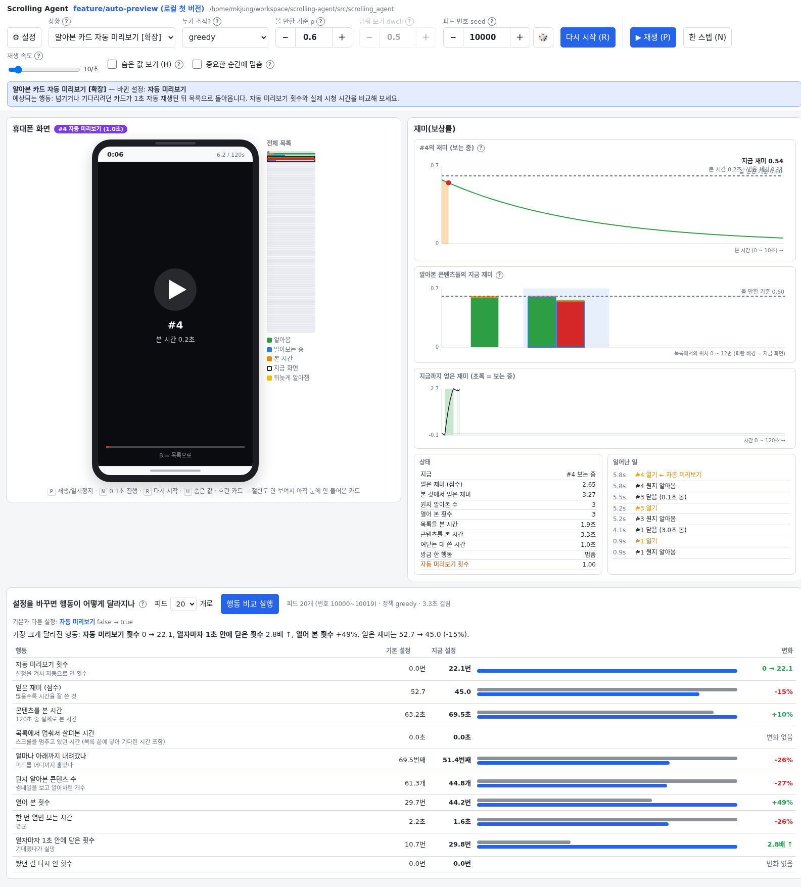
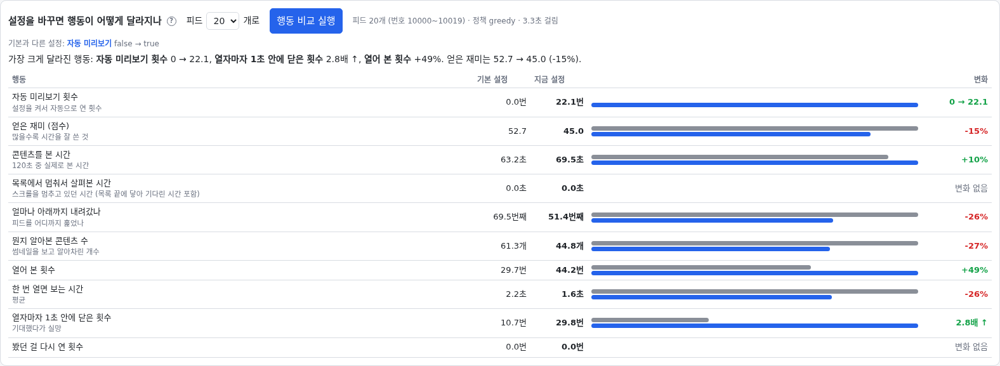

# 자동 미리보기 — 첫 버전

화면에서 알아본 콘텐츠를 자동으로 잠깐 보여 주는 기능이다. 사용자가 고르기 전에
짧은 영상이 재생되는 앱의 경험을 단순화했다.

- 기준 브랜치: `feature/web-demo` (`baeee8a`)
- 작업 브랜치: `feature/auto-preview`
- 새 기능은 기본값 **꺼짐**이다.

## 동작

1. 목록에서 넘기거나 기다리려 할 때, 화면에 보이는 카드 중 **알아봤고 아직 시청하지 않은 카드**를 위에서부터 찾는다.
2. 해당 카드를 자동으로 열어 **1초 시청**한 뒤 목록으로 돌아온다.
3. 같은 카드는 한 에피소드에서 한 번만 자동 미리보기한다. 다시 시작하면 기록을 초기화한다.

명시적으로 카드를 여는 행동이 우선이다. 직접 연 카드는 기존 정책이나 사용자 조작에 따라
시청하며, 1초 뒤 자동으로 닫지 않는다. 미리보기의 시청 시간과 보상은 일반 시청과 동일하게
누적하고, 나중에 같은 카드를 직접 다시 볼 수 있다.

기본값에서는 열기·닫기에 각각 0.2초가 별도로 들어 미리보기 한 번에 총 1.4초를 쓴다.
시청 중에는 목록을 알아보는 과정(DDM)이 진행되지 않는다.

## 새 설정

| 설정 | 기본값 | 설명 |
|---|---|---|
| `preview.enabled` | `false` | 자동 미리보기 켜기 |
| `preview.seconds` | `1.0` | 실제 시청 시간(초). 열기·닫기 시간 제외 |

`preview.seconds`는 유한한 양수여야 한다. 판단 간격 `time.dt` 단위로 올림하므로,
기본 간격 0.1초에서 0.25초를 입력하면 실제로 0.3초 시청한다.
기능이 꺼져 있으면 이 값은 행동에 영향을 주지 않는다.

## 실행과 확인

저장소 루트에서 다음과 같이 실행한다. 이미 8010번 서버가 켜져 있으면 링크로 바로 접속한다.

```bash
.venv/bin/python scripts/serve.py --port 8010 --open
```

Windows에서는 `.venv\Scripts\python.exe scripts\serve.py --port 8010 --open`을 사용한다.
이번 확장은 8010번 단일 데모에서 확인한다.

1. [자동 미리보기 장면 열기](http://127.0.0.1:8010/?scenario=auto_preview&policy=greedy&rho=0.6&dwell=0.5&seed=10000&skip=62&speed=10&hidden=0&pause=0&autoplay=0).
2. 6.2초 시점의 `#4 자동 미리보기 (1.0초)` 표시를 확인한다. **재생**하면 7.2초에 목록으로 돌아온다.
3. **다시 시작**하면 0초부터 볼 수 있다. 재생 속도 10스텝/초는 기본 판단 간격에서 실제 시간과 같다.
4. 화면 아래 **행동 비교**에서 피드 20개를 비교한다. 회색 막대가 기본 설정, 파란 막대가 자동 미리보기를 켠 설정이다.
5. [기본 설정 장면](http://127.0.0.1:8010/?scenario=base&policy=greedy&rho=0.6&dwell=0.5&seed=10000&skip=62&speed=10&hidden=0&pause=0&autoplay=0)과 비교하거나, **설정 → preview → 자동 미리보기**를 끄고 **적용하고 다시 시작**한다.



## 간단한 결과

동일한 피드 20개에서 꺼짐·켜짐을 비교했다. 아래 값은 에피소드별 측정값의 평균이다.

| 측정값 | 꺼짐(기본) | 켜짐(1초) |
|---|---:|---:|
| 자동 미리보기 횟수 | 0회 | 22.1회 |
| 열어 본 횟수(자동 포함) | 29.7회 | 44.2회 |
| 콘텐츠를 본 시간 | 63.195초 | 69.515초 |
| 얻은 재미(누적 보상) | 52.656 | 45.009 |

이 조건에서는 콘텐츠를 더 자주 열고 시청 시간도 늘었지만, 얻은 재미는 줄었다.
볼 만한 기준에 못 미쳐 넘기려던 카드도 자동으로 보면서 시간을 쓰기 때문이다.
“자동 재생 때문에 더 많이 보게 되지만, 그만큼 만족스럽지는 않다”는 경험과 연결해 볼 수 있다.
이는 이 설정과 피드에서의 시뮬레이션 결과이며, 실제 사람을 측정한 결과는 아니다.



재현 설정:

| 항목 | 값 |
|---|---|
| 브랜치 / 실행 주소 | `feature/auto-preview` / `http://127.0.0.1:8010/` |
| 정책 | `greedy` |
| ρ / dwell | `0.6` / `0.5` (`greedy`에서는 dwell 미사용) |
| 바꾼 설정 | `preview.enabled: false → true`, `preview.seconds: 1.0` 유지 |
| 장면 seed / 시점 | `10000` / 6.2초(`skip=62`) |
| 비교 피드 | 20개, seed `10000`~`10019` |
| 에피소드 / 판단 간격 | 120초 / 0.1초 |
| 기타 설정 | 기본값 유지 |

## 검증과 범위

```bash
.venv/bin/python -m pytest tests/test_auto_preview.py -q
.venv/bin/python -m pytest -q
node --check webdemo/static/app.js
```

- 추가 테스트 14개, 전체 테스트 **113개 통과**.
- 자동 시청 시간, 목록 복귀, 직접 열기 우선, 카드별 한 번 제한, 초기화, 잘못된 시간값 거부,
  웹 데모의 실제 행동 집계와 비교 수치를 확인했다.
- 기능을 끈 환경을 원래 `feature/web-demo` 환경과 4개 에피소드·4,800스텝 비교해
  관측값·보상·행동 마스크·종료 정보가 같음을 확인했다.
- Chrome에서 미리보기 표시, 자동 목록 복귀, 기본 설정으로 전환을 확인했다. JavaScript 예외는 없었다.

첫 버전은 미리보기 도중 닫기를 요청해도 설정한 시간까지 재생한다. 재생을 잠시 멈추는
기존 버튼은 사용할 수 있다. 목록 안에서 영상 자체를 재생하거나 별도의 이어보기 버튼을
추가하지는 않았으며, 기존 시청 화면을 이용한다. PPO 재학습은 수행하지 않았다.
기존의 ‘열자마자 1초 안에 닫은 횟수’에는 자동 미리보기도 포함되므로 모두 실망으로 해석하지 않는다.
