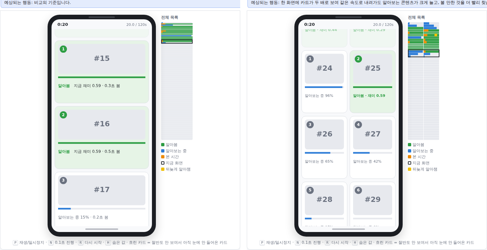

# Extension — Shopping grid (`screen.columns`)

Draft status: not in the draft — a team extension (Task#3, 쇼핑 2열 그리드 아이디어).
Default: off (`screen.columns = 1` reproduces the draft model exactly; checked against
episode fingerprints recorded on `feature/web-demo`, see Tests).

## Model

Shopping apps show products in a grid, usually two cards side by side. With
`columns = C`, cards sit C to a row:

    item i  ->  row r = i // C, column i % C
    rows    =  ceil(n_items / C)          (the last row may be partly empty)
    scroll  in rows: 0 <= s <= rows - H,  H = cards_per_screen read as rows per screen
    slots   = (ceil(H) + 1) * C, ordered row by row, left to right

- The visibility rule (`visible_fraction`) is applied per row: all C cards of a
  row enter and leave the screen together, and the DDM runs for all of them at
  once, exactly as for the cards of a single column.
- Scroll speed stays in screen heights / s, so a row passes in the same time a
  card passes in the draft; C cards go by in that time instead of one.
- Observation: the slot "top offset" and the memory "offset from screen centre"
  use the item's row. The vector length grows with the slot count (`8` slots for
  C = 2 instead of `4`); nothing else changes, so a PPO model trained with C = 1
  cannot be loaded with C = 2.
- The baselines need no change: item ids still increase down the list, so
  "scroll up if the target is above the screen" keeps working.

| Setting | Default | Meaning |
|---|---|---|
| `screen.columns` | 1 | cards per row; 1 = draft single column, 2 = shopping 2-column grid |

## What changes (greedy, rho 0.6, 20 feeds, seeds 10000–10019)

| | 1 column, 3 cards (draft) | **2 columns, 3 rows (6 cards)** | 1 column, 6 cards |
|---|---|---|---|
| Return | 52.7 | **66.5** (+26%) | 67.3 |
| Items understood | 61.3 | **73.5** | 73.7 |
| How far down (item #) | 69.5 | **86.7** | 86.4 |
| Time watching (s) | 63.2 | **77.5** | 77.8 |
| Clicks | 29.7 | **36.2** | 36.2 |

- **More found, more watched**: with the same scroll speed the grid passes twice
  as many cards per second, understands about 20% more of them and finds worth-
  watching items sooner, so the agent spends more of the 120 s watching.
  `greedy-dwell` (dwell 0.5) gains even more: 42.0 → 59.3, and its time stopped in
  the list falls 24.7 → 16.3 s because it waits for a whole row at once.
  `scrollfirst` behaves like `greedy` (52.9 → 66.3).
- **Main finding — in the draft model a grid is just a bigger screen.** A 2-column
  grid with 3 rows gives almost the same numbers as a single column with
  `cards_per_screen = 6` (last column above). In both cases 6 cards are on screen,
  3 cards pass per second and each stays about 2 s, and the draft DDM processes
  every visible card in parallel at full speed. So the grid's advantage comes
  entirely from "more cards at once, for free".
- That "for free" is the doubtful part: people cannot read six thumbnails at the
  same time. Combining this with the attention-split branch (`ddm.attention`,
  screen crowding) should make the grid's benefit shrink, and smaller grid cards
  (fewer pixels per thumbnail → lower `nu`) would shrink it further. Not
  measured here; both are natural next steps.

## Demo

The phone draws C cards per row with shorter labels ("알아봄 · 재미 0.59",
"알아보는 중 42%"); slot numbers run row by row, so keys `1`–`8` open the cards in
human mode. The list map on the right is split into C columns, and the "screen"
band of the rate chart covers all items on screen. The server sends `columns`
in the state (1 on branches without this setting). Situation: "쇼핑 앱 2열
그리드 [확장]" (`?scenario=grid2`).

## Tests

`tests/test_grid.py` — default is one column, one-column visibility and two full
episodes identical to the draft model (fingerprints from `feature/web-demo`),
row-based visibility with half-visible edge rows and a partly empty last row,
`max_scroll` in rows, Gymnasium `check_env` with C = 2, both cards of a row
processed together, clicking the right-hand card opens it, time still sums to T,
two columns understand more items, web-demo state and situation.
