# Scrolling Agent 웹 데모 사용 가이드

브라우저에서 스크롤 에이전트가 피드를 넘기고, 알아보고, 열어 보는 모습을 실시간으로 보고 직접 조작해 보는 도구의 사용 설명서입니다.

| 장 | 내용 | 상태 | 작성 |
|---|---|---|---|
| 1 | 처음 한 번 준비하기 | 작성됨 | 박준호 |
| 2 | 실행하고 페이지 열기 | 작성됨 | 박준호 |
| 3 | 화면 각 부분의 역할 | 작성됨 | 팀원 전체 (세은·수민·도현·하늘) |
| 4 | 이 문서에 추가하는 방법 | 작성됨 | 박준호 |

> 처음 보는 분은 1장 → 2장 순서대로 따라 하면 됩니다. 3장을 쓰실 분은 4장을 먼저 읽어 주세요.

---

## 1. 처음 한 번 준비하기

Windows PowerShell 기준입니다. VS Code에서 **터미널 → 새 터미널**(`` Ctrl + ` ``)을 열고 순서대로 실행합니다.

```powershell
# 1) 코드 받기 (처음 한 번)
git clone https://github.com/jznpark/scrolling-agent.git C:\Workspace\scrolling-agent
cd C:\Workspace\scrolling-agent
git switch feature/web-demo

# 2) 가상환경 만들고 설치 (처음 한 번, 몇 분 걸림)
python -m venv .venv
.\.venv\Scripts\Activate.ps1
pip install -e ".[dev]"

# 3) 잘 설치됐는지 확인 — 마지막 줄에 "passed"가 나오면 성공
pytest
```

- 새 터미널을 열 때마다 `.\.venv\Scripts\Activate.ps1`을 다시 실행해야 합니다. 줄 앞에 `(.venv)`가 보이면 켜진 상태입니다.
- `Activate.ps1`에서 "스크립트를 실행할 수 없습니다" 오류가 나면 먼저 아래를 실행하세요.
  ```powershell
  Set-ExecutionPolicy -Scope Process -ExecutionPolicy RemoteSigned
  ```
- 이미 받아 둔 경우에는 최신으로만 바꾸면 됩니다: `git switch feature/web-demo` → `git pull`

---

## 2. 실행하고 페이지 열기

### 2.1 내 PC에서 실행하기

```powershell
cd C:\Workspace\scrolling-agent
.\.venv\Scripts\Activate.ps1
python scripts\serve_branches.py --open
```

터미널에 아래처럼 나오면 실행된 것입니다. `--open`을 붙이면 브라우저가 자동으로 열립니다.

```text
  /b/1/  feature/ppo @ 39580c0
  /b/2/  feature/value-error @ 3a53ef7
  /b/3/  feature/offscreen-residual @ a57c720
  /b/4/  feature/attention-split @ 445b875
Comparison page: http://127.0.0.1:8000  - Ctrl+C to stop all
```

- 자동으로 안 열리면 브라우저 주소창에 **http://127.0.0.1:8000** 을 입력합니다.
- 이 터미널은 **켜 둔 채로** 두어야 페이지가 동작합니다. 끌 때는 터미널에서 `Ctrl + C`.
- 브랜치 하나만 빠르게 보고 싶으면 `python scripts\serve.py --open` (지금 선택된 브랜치만, 탭 없음).

### 2.2 페이지 열기 — 탭으로 모델 고르기

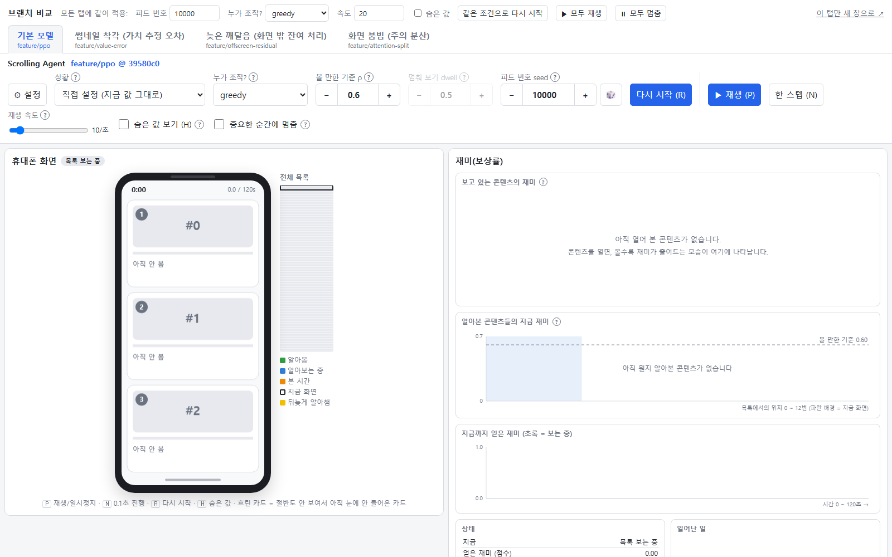

- **위쪽 탭**을 누르면 화면이 통째로 바뀝니다. 탭마다 다른 모델(브랜치)입니다.

  | 탭 | 무엇이 다른가 |
  |---|---|
  | 기본 모델 | 교수님 초안 그대로 |
  | 썸네일 착각 | 썸네일만 보고 재미를 잘못 짐작함 |
  | 늦은 깨달음 | 지나간 카드를 뒤늦게 알아차리고 되돌아감 |
  | 화면 붐빔 | 화면에 모르는 카드가 많으면 알아보기가 느려짐 |

- **맨 위 줄**(피드 번호, 누가 조작?, 속도, 같은 조건으로 다시 시작, 모두 재생/멈춤)은 **모든 탭에 한꺼번에** 적용됩니다. 같은 조건에서 모델끼리 비교할 때 씁니다.
- 탭 하나만 크게 보려면 오른쪽 위 **이 탭만 새 창으로 ↗**.
- 주소 끝에 `#3`을 붙이면 세 번째 탭이 바로 열립니다: `http://127.0.0.1:8000/#3`

탭 안의 화면은 이렇게 생겼습니다(기본 모델, 20초 진행 후). 각 부분의 역할은 3장에서 설명합니다.

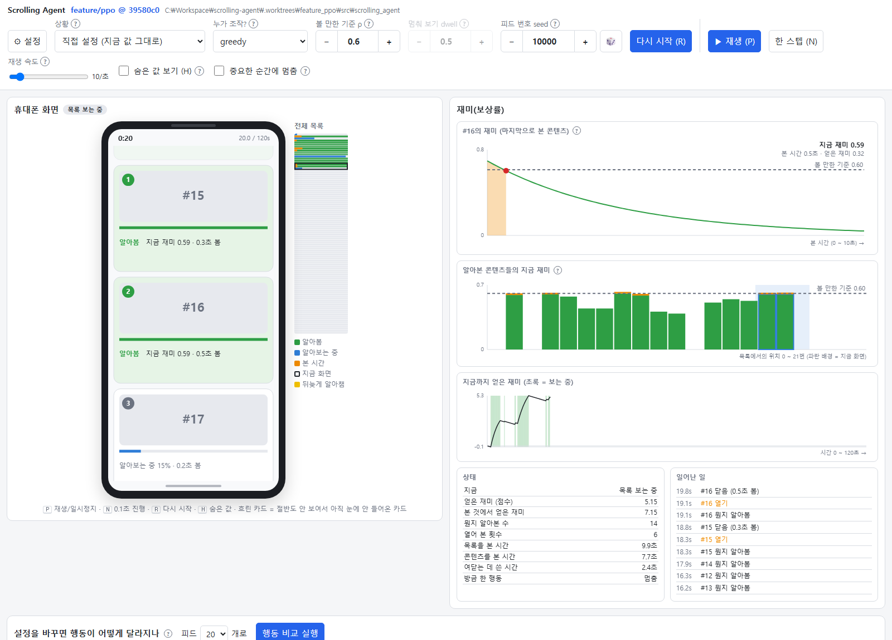

### 2.3 같은 와이파이(같은 공유기)의 다른 PC에서 열기

```powershell
python scripts\serve_branches.py --host 0.0.0.0
```

- 터미널에 `same network: http://192.168.x.x:8000` 주소가 나옵니다. 다른 PC 브라우저에서 이 주소로 엽니다.
- 처음 한 번은 **관리자 권한 PowerShell**에서 방화벽을 열어야 합니다.
  ```powershell
  New-NetFirewallRule -DisplayName "scrolling-agent demo" -Direction Inbound -Protocol TCP -LocalPort 8000 -Action Allow -Profile Private,Domain
  ```
- 실행할 때 "Python 액세스 허용" 창이 뜨면 **개인 네트워크**만 체크하고 허용합니다.
- `192.168.…` 주소는 **같은 공유기 안에서만** 열립니다. 다른 곳에 있는 팀원은 2.4를 쓰세요. 학교 와이파이도 기기끼리 연결을 막는 경우가 많아 2.4가 필요합니다.

### 2.4 다른 곳에 있는 팀원에게 링크로 공유하기 (Cloudflare 터널)

터미널 두 개가 필요합니다. VS Code 터미널 패널의 **`+`**(또는 `` Ctrl + Shift + ` ``)로 하나 더 엽니다.

```powershell
# 처음 한 번: 터널 프로그램 설치 (설치 후에는 새 터미널을 열어야 인식됩니다)
winget install --id Cloudflare.cloudflared

# 터미널 1: 비밀번호를 걸고 실행
python scripts\serve_branches.py --token 우리팀비번

# 터미널 2: 터널 열기 (venv 필요 없음)
cloudflared tunnel --url http://localhost:8000
```

터미널 2에 이런 상자가 나오면 그 주소가 외부 공개 주소입니다.

```text
|  Your quick Tunnel has been created! Visit it at (it may take some time to be reachable):  |
|  https://xxxx-xxxx-xxxx-xxxx.trycloudflare.com                                             |
```

팀원에게는 **비밀번호를 붙인 주소**를 보냅니다.

```text
https://xxxx-xxxx-xxxx-xxxx.trycloudflare.com/?token=우리팀비번
```

비밀번호 없이 들어오면 아래 화면이 나옵니다. 비밀번호를 넣고 **들어가기**를 누르면 됩니다(한 번 들어오면 브라우저가 기억).

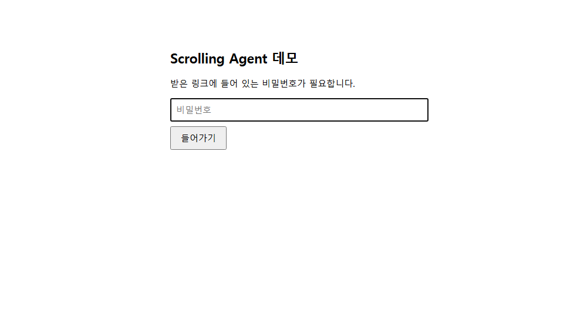

- 터미널 1, 2를 **둘 다 켜 둬야** 접속됩니다. 끄면 바로 닫힙니다.
- 터널을 다시 켜면 **주소가 바뀝니다** → 새 주소를 다시 공유하세요.
- 처음 1분 정도는 접속이 안 될 수 있습니다. 잠시 후 새로고침.
- `--token` 없이 열면 링크를 아는 누구나 들어올 수 있으니 꼭 비밀번호를 거세요.

### 2.5 주소로 원하는 상태를 바로 열기

공유할 때 "이 장면을 봐" 하고 보내기 좋습니다. 탭 안의 화면 주소(`/b/번호/`) 뒤에 붙입니다.

| 붙이는 것 | 뜻 | 예 |
|---|---|---|
| `scenario=상황이름` | 상황 고르기를 적용하고 행동 비교까지 실행 | `scenario=late` (늦은 깨달음), `scenario=boring_fast` (금방 질림) |
| `skip=숫자` | 그만큼(0.1초 단위) 진행한 장면부터 | `skip=112` → 11.2초 |
| `policy=이름` | 누가 조작할지 | `policy=human` (직접 해 보기) |
| `seed=숫자` | 피드 번호 | `seed=10003` |
| `hidden=1` | 숨은 값 보기 켜기 | |
| `pause=1` | 중요한 순간에 멈춤 켜기 | |
| `autoplay=1` | 열자마자 재생 | |

예: 늦은 깨달음 탭에서 11.2초 장면

```text
http://127.0.0.1:8000/b/3/?scenario=late&skip=112
```

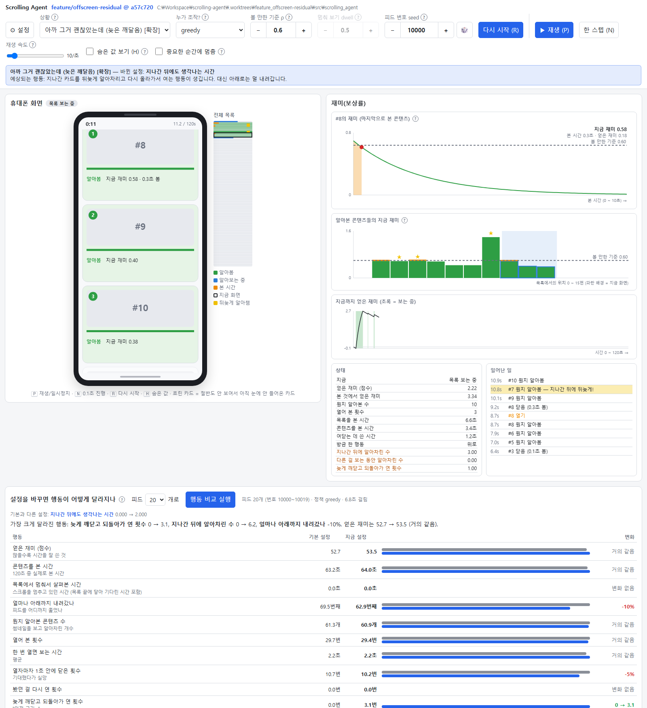

상황 이름 목록은 `webdemo/descriptions.py`의 `SCENARIOS`에 있습니다.

### 2.6 자주 나는 문제

| 증상 | 원인과 해결 |
|---|---|
| `cloudflared`(이)가 인식되지 않습니다 | 설치 안 됨 → `winget install --id Cloudflare.cloudflared` 후 **새 터미널**에서 실행 |
| `Activate.ps1` 실행 오류 | `Set-ExecutionPolicy -Scope Process -ExecutionPolicy RemoteSigned` 후 다시 |
| `[WinError 10048] 각 소켓 주소(…)는 하나만 사용할 수 있습니다` 또는 `server for … stopped` | 이미 서버가 켜져 있음(포트 사용 중) → 켜져 있는 터미널에서 `Ctrl + C`, 또는 `--port 8100`처럼 다른 번호로 실행 |
| 비밀번호 화면이 계속 나옴 | 주소의 `?token=` 값이 터미널 1의 `--token` 값과 다름 |
| 탭 안이 하얗게 비어 있음 | 터미널 1이 꺼졌거나 아직 시작 중 → 터미널 확인 후 새로고침 |
| 다른 PC에서 안 열림 | 같은 공유기가 아니면 2.3이 아니라 2.4(터널)를 써야 함 |

---

## 3. 화면 각 부분의 역할 — 팀원 작성 부분

> **이 장은 팀원들이 나눠서 채웁니다.** 맡을 칸의 "담당"에 이름을 적고, 4장의 방법대로 캡처와 설명을 넣어 주세요.
> 각 칸 아래의 `<!-- TODO -->`를 지우고 그 자리에 씁니다. 3.0의 작성 예시 형식을 따라 주세요.

| 절 | 화면 부분 | 담당 | 상태 |
|---|---|---|---|
| 3.1 | 위쪽 조작 막대 (상황, 누가 조작?, 볼 만한 기준, 멈춰 보기, 피드 번호, 재생) | 세은 | 작성됨 |
| 3.2 | 왼쪽: 휴대폰 화면과 전체 목록 지도 | 수민 | 작성됨 |
| 3.3 | 오른쪽: 재미 그래프 3개 | 도현 | 작성됨 |
| 3.4 | 상태 표와 일어난 일 | 도현 | 작성됨 |
| 3.5 | 아래쪽: 행동 비교 | 백하늘 | 작성됨 |
| 3.6 | ⚙ 설정 서랍 (모든 설정, ? 설명) | 세은 | 작성됨 |
| 3.7 | 직접 해 보기 (human 모드 키 조작) | 수민 | 작성됨 |
| 3.8 | 비교 페이지의 탭과 맨 위 줄 | 백하늘 | 작성됨 |

### 3.0 작성 예시 (형식 참고용 — 실제 3.x를 쓸 때 이 모양으로)

> **화면 부분 이름** — 한 줄로 무엇을 하는 곳인지
>
> 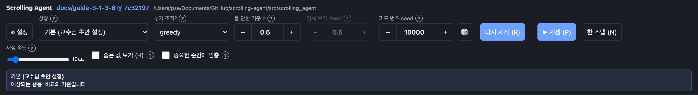
>
> | 표시 | 뜻 | 이렇게 써 보세요 |
> |---|---|---|
> | 볼 만한 기준 ρ | 이 정도 재미면 볼 만하다는 기준 | ＋를 눌러 0.9로 올리고 재생 → 조금 보고 자주 닫는지 관찰 |
>
> **알아 두면 좋은 점**: 한두 줄

### 3.1 위쪽 조작 막대

**위쪽 조작 막대** — 무엇을(상황·피드), 누가(정책), 어떤 기준으로(ρ·dwell) 돌릴지 정하고, 재생을 조종하는 곳입니다.


맨 왼쪽 위에는 지금 돌고 있는 **브랜치 이름 @ 커밋**이 나옵니다. 비교 페이지라면 탭에서 고른 모델이 여기 표시됩니다.
각 칸의 `?`에 마우스를 올리면 쉬운 설명이 나옵니다.

**무엇을 돌릴지 정하는 칸**

| 표시 | 뜻 | 이렇게 써 보세요 |
|---|---|---|
| ⚙ 설정 | 모든 설정을 바꿀 수 있는 서랍을 엽니다(3.6). | 여기 없는 세부 값(질리는 속도 등)을 바꿀 때 엽니다. |
| 상황 | 자주 궁금한 상황을 고르면 관련 설정이 자동으로 바뀌고, 바로 다시 시작됩니다. 막대 아래에 **바뀐 설정**과 **예상되는 행동**이 나오고, 아래쪽 행동 비교(3.5)도 자동으로 돕니다. | `좋은 콘텐츠가 드문 피드`를 골라 보세요. 예상 글귀와 실제 행동을 맞춰 보면 됩니다. 첫 항목 `직접 설정`은 지금 값 그대로 두는 선택입니다. |
| 누가 조작? | 휴대폰을 조작할 주체입니다. `human`(내가 키보드로, 3.7) / `random` / `scrollfirst`(내리다가 처음 알아본 것 열기) / `greedy`(알아본 것 중 제일 재밌어 보이는 것 열기) / `greedy-dwell`(greedy + 모르는 카드 앞에서 잠깐 멈춤) / `ppo:이름`(학습한 인공지능). | `scrollfirst`와 `greedy`를 번갈아 돌려, 지나친 콘텐츠로 되돌아가는지가 어떻게 다른지 보세요. |
| 볼 만한 기준 ρ | "이 정도 재미면 볼 만하다"는 기준입니다. 알아본 콘텐츠의 지금 재미가 ρ보다 크면 열고, 보다가 ρ 아래로 떨어지면 닫습니다. 오른쪽 그래프의 점선이 이 값입니다(3.3). | ＋를 눌러 0.9로 올리고 **다시 시작 (R)** → 조금 보고 자주 닫는지, 0.3으로 내리면 아무거나 오래 보는지 비교하세요. |
| 멈춰 보기 dwell | `greedy-dwell`에서, 아직 뭔지 모르는 카드 앞에 최대 몇 초 멈춰 설지입니다. 다른 정책에서는 흐리게 꺼져 있습니다. | 정책을 `greedy-dwell`로 바꾸면 칸이 살아납니다. 0으로 두면 멈추지 않는 greedy와 같아집니다. |
| 피드 번호 seed | 어떤 피드(콘텐츠 목록)를 쓸지 고르는 번호입니다. 같은 번호면 언제나 같은 피드라서, 설정만 바꿔 공정하게 비교할 수 있습니다. 🎲는 무작위 번호입니다. | 캡처나 영상에 남길 장면은 seed를 적어 두세요. 같은 번호로 누구나 같은 장면을 다시 만들 수 있습니다. |

**재생을 조종하는 칸**

| 표시 | 뜻 | 이렇게 써 보세요 |
|---|---|---|
| 다시 시작 (R) | 지금 고른 상황·정책·ρ·dwell·seed·설정으로 처음(0초)부터 다시 돌립니다. **ρ, dwell, 설정 변경은 다시 시작해야 행동에 적용됩니다.** | 값을 바꿨는데 행동이 그대로면 먼저 R을 눌렀는지 확인하세요. |
| ▶ 재생 (P) | 시간이 흐르기 시작합니다. 다시 누르면 일시정지. | 일시정지 후 아래 `한 스텝`과 함께 쓰면 장면을 천천히 뜯어볼 수 있습니다. |
| 한 스텝 (N) | 한 번의 판단 간격(기본 0.5초)만큼만 진행합니다. | 콘텐츠가 열리는 순간 일시정지하고 N을 연타하며 그래프 변화를 관찰해 보세요(3.3). |
| 재생 속도 | 화면이 흘러가는 빠르기입니다. 10이 실제 속도, 100이면 10배 빠르게. | 전체 흐름은 빠르게 훑고, 궁금한 구간에서 10으로 낮추세요. |
| 숨은 값 보기 (H) | 실제로는 열어 보기 전까지 모르는 정보(진짜 재미, 좋은 콘텐츠인지)를 분석용으로 겹쳐 보여 줍니다. | 에이전트가 "놓친" 좋은 콘텐츠가 어디 있었는지 확인할 때 켭니다. |
| 중요한 순간에 멈춤 | 늦은 깨달음(지나간 카드를 뒤늦게 알아챔)이나 그 카드로 되돌아가 여는 순간에 자동으로 멈추고 안내를 띄웁니다. | `늦은 깨달음` 상황과 함께 켜 두면 결정적 장면을 놓치지 않습니다. |

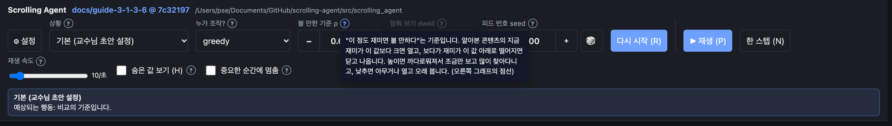

**알아 두면 좋은 점**: 괄호 속 글자(R, P, N, H)는 키보드 단축키입니다. 캡처 속 `멈춰 보기 dwell`이 흐린 것은 정책이 `greedy`라 쓰이지 않기 때문입니다.
막대에서 고른 값들은 2.5의 주소(`?scenario=…&policy=…&seed=…`)로도 그대로 적을 수 있어, 같은 장면을 링크로 공유할 때 씁니다.

### 3.2 왼쪽: 휴대폰 화면과 전체 목록 지도
> **휴대폰 화면과 전체 목록 지도** — 지금 휴대폰에 무엇이 보이는지, 피드 전체에서 어디까지 봤는지를 보여 주는 곳
>
> 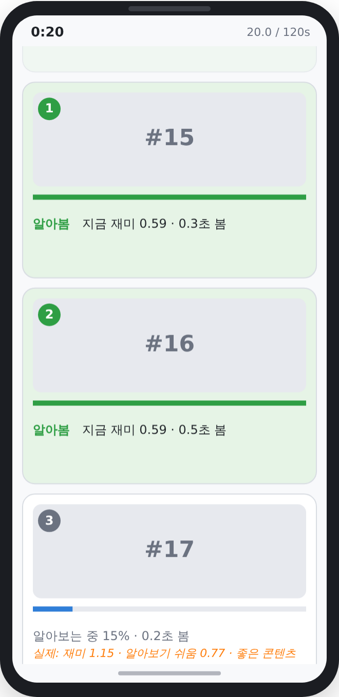
>
> | 표시 | 뜻 | 이렇게 써 보세요 |
> |---|---|---|
> | 카드 왼쪽 위 번호 동그라미 (1~4) | 지금 화면에서 눈에 들어온 카드의 순서. 초록이면 열 수 있고, 회색이면 아직 뭔지 몰라 못 엶 | 일시정지(P)하고 N으로 한 칸씩 넘기며 회색이 초록으로 바뀌는 순간을 보기 |
> | 파란 막대 + "알아보는 중 ○%" | 썸네일을 보고 뭔지 알아가는 중. 100%가 되면 알아봄 | ⚙ 설정에서 스크롤 속도를 올리고 재생 → 막대가 덜 찬 채로 지나가는지 보기 |
> | 초록 카드 + "알아봄 · 지금 재미" | 뭔지 알아서 재미가 얼마인지 드러남. 볼수록 "지금 재미"가 줄어듦 | 볼 만한 기준 ρ보다 "지금 재미"가 높은 카드를 여는지 확인 |
> | 흐린 카드 | 화면에 절반도 안 보여서 아직 눈에 안 들어온 카드 | 화면 맨 위·맨 아래 카드가 흐려졌다 진해지는 것 보기 |
> | ★ 뒤늦게 알아챔 | 화면에서 지나간 뒤에야 알아차린 카드 ("늦은 깨달음" 탭에서만) | 늦은 깨달음 탭에서 상황 "아까 그거 괜찮았는데"를 고르고 재생 |
> | 검은 화면 + ▶ | 카드를 열어 보는 중. 본 시간이 올라가고, 제목 옆이 "#번호 보는 중"으로 바뀜 | 열고 닫을 때 "여는 중…" 화면이 잠깐(0.2초) 나오는 것 확인 |
>
> 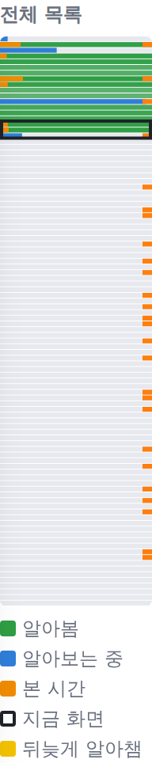
>
> | 지도의 표시 | 뜻 |
> |---|---|
> | 가로 한 줄 | 콘텐츠 하나. 맨 위가 #0, 아래로 갈수록 피드 뒤쪽 |
> | 회색 | 아직 화면에 나온 적 없음 |
> | 파란색 (일부만 칠해짐) | 알아보는 중. 칠해진 길이 = 알아본 정도 |
> | 초록색 | 알아봄. 진할수록 지금 재미가 큼 |
> | 왼쪽 주황 막대 | 열어서 본 시간. 길수록 오래 봄 |
> | 노란 표시 | 뒤늦게 알아챔 |
> | 검은 테두리 상자 | 지금 휴대폰 화면에 보이는 범위 |
> | 빨간 줄 | 지금 열어서 보고 있는 콘텐츠 |
>
> **알아 두면 좋은 점**: H로 "숨은 값 보기"를 켜면 카드 아래에 실제 재미가 기울임 글씨로 나오고, 지도 오른쪽 끝에 좋은 콘텐츠가 주황으로 표시됩니다(위 캡처). 실제 사람은 모르는 값이라 비교용으로만 씁니다.

### 3.3 오른쪽: 재미 그래프 3개

**재미 그래프 3개** — 지금 보는 콘텐츠의 재미, 알아본 후보들의 재미, 세션 전체에서 얻은 점수를 위에서부터 차례로 보여 줍니다.

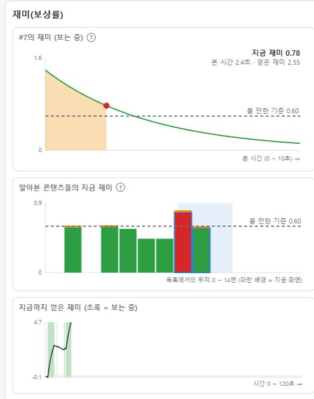

**① 보고 있는 콘텐츠의 재미**

| 표시 | 뜻 | 이렇게 써 보세요 |
|---|---|---|
| 제목의 `#번호`와 `보는 중` | 지금 열어 보고 있는 콘텐츠의 번호입니다. 목록으로 나오면 마지막으로 본 콘텐츠가 남습니다. | 콘텐츠가 닫힌 뒤 제목이 `마지막으로 본 콘텐츠`로 바뀌는지 확인합니다. |
| 초록 곡선 | 해당 콘텐츠를 오래 볼수록 줄어드는 재미입니다. 가로축은 **그 콘텐츠를 본 누적 시간**, 세로축은 재미의 크기입니다. | `한 스텝 (N)`을 누르며 본 시간이 늘 때 재미가 줄어드는지 봅니다. |
| 빨간 점과 `지금 재미` | 지금까지 본 시간에 해당하는 곡선 위의 위치와 재미입니다. | 빨간 점이 `볼 만한 기준` 점선에 가까워지는지 봅니다. |
| 주황색으로 칠한 넓이와 `얻은 재미` | 이 콘텐츠에서 지금까지 얻은 재미입니다. 매 스텝 비용을 빼기 전 값입니다. | 시청이 이어질 때 색칠된 구간이 오른쪽으로 늘어나는지 확인합니다. |
| `본 시간` | 이 콘텐츠를 실제로 본 시간입니다. 닫았다가 다시 열어도 이전에 본 시간이 이어집니다. | 화면 전체의 경과 시간과 비교합니다. 위 캡처는 세션 12초에 #7을 2.4초 본 장면입니다. |

아직 아무 콘텐츠도 열지 않았다면 `아직 열어 본 콘텐츠가 없습니다.`가 나옵니다. 목록을 훑는 동안에는 이 콘텐츠의 본 시간이 늘지 않습니다.

**② 알아본 콘텐츠들의 지금 재미**

| 표시 | 뜻 | 이렇게 써 보세요 |
|---|---|---|
| 막대의 위치와 높이 | 가로축은 목록에서의 콘텐츠 위치입니다. 높이는 그 콘텐츠의 지금 재미입니다. 아직 알아보지 못한 콘텐츠는 막대가 없습니다. | 휴대폰 화면의 `#번호`와 막대 위치를 맞춰 봅니다. |
| 초록 막대 / 빨간 막대 | 초록은 알아본 콘텐츠, 빨강은 현재 보고 있는 콘텐츠입니다. | 콘텐츠를 열었을 때 해당 막대가 빨강으로 바뀌는지 봅니다. |
| 파란 배경 / 파란 테두리 | 파란 배경은 현재 목록 화면의 범위입니다. 파란 테두리는 현재 화면의 선택 가능한 카드입니다. | 목록을 내릴 때 파란 영역이 이동하는지 봅니다. |
| 막대 위 주황색 선 | 실제로 본 적이 있는 콘텐츠입니다. | 닫고 목록으로 돌아온 뒤에도 표시가 남는지 봅니다. |
| `볼 만한 기준` 점선 | 위쪽 조작 막대의 **볼 만한 기준 ρ**입니다. 이 기준을 쓰는 정책은 기준 이상의 후보를 열고, 보던 콘텐츠의 재미가 기준 아래로 내려가면 닫습니다. | `greedy`에서 점선과 빨간 막대 높이를 비교합니다. |

점선은 `scrollfirst`, `greedy`, `greedy-dwell`에서만 나옵니다. ρ를 바꿔 실제 행동을 비교하려면 **다시 시작 (R)**을 눌러 새 기준을 적용하세요. `늦은 깨달음` 탭에서는 지나간 뒤 알아챈 콘텐츠의 막대 위에 노란 `★`도 붙습니다.

**③ 지금까지 얻은 재미 (초록 = 보는 중)**

| 표시 | 뜻 | 이렇게 써 보세요 |
|---|---|---|
| 가로축 `시간 0 ~ 120초` | 세션 시작부터 흐른 시간입니다. 기본 세션은 120초이며, 설정을 바꾸면 축의 끝도 바뀝니다. | 첫 번째 그래프의 `본 시간`과 구분해서 읽습니다. |
| 검은 선 | 모든 콘텐츠에서 얻은 재미를 합하고, 지금까지의 매 스텝 비용을 뺀 누적 점수입니다. 아래 상태 표의 `얻은 재미 (점수)`와 같은 값입니다. | 현재 선의 끝과 상태 표의 점수를 함께 확인합니다. |
| 연한 초록 배경 | 콘텐츠를 보는 중인 구간입니다. | 초록 구간에서 점수가 얼마나 올라가는지 봅니다. |
| 선이 내려가는 구간 | 목록을 보거나 여닫는 동안에도 비용이 들기 때문에 점수가 줄 수 있습니다. 시청 중에도 얻는 재미가 비용보다 작으면 줄어듭니다. | 콘텐츠를 닫은 뒤 다음 것을 찾는 구간을 관찰합니다. |

**이렇게 써 보세요**

1. `기본 모델` 탭에서 상황을 `기본 (교수님 초안 설정)`, 정책을 `greedy`, ρ를 `0.6`, seed를 `10000`으로 맞춥니다. **다시 시작 (R)**을 누르고 재생합니다.
2. 콘텐츠가 열리면 일시정지하고 **한 스텝 (N)**으로 진행합니다. 첫 번째 그래프의 빨간 점과 주황색 넓이, 두 번째 그래프의 빨간 막대를 함께 봅니다.
3. 콘텐츠가 닫히면 첫 번째 그래프의 제목과 세 번째 그래프의 점수 변화를 확인합니다.

캡처와 같은 12초 장면은 2.1의 비교 서버를 기본 포트로 실행한 뒤 아래 주소로 열 수 있습니다. dwell은 `0.5`이며, `greedy`에서는 사용하지 않습니다.

```text
http://127.0.0.1:8000/b/1/?scenario=base&policy=greedy&seed=10000&rho=0.6&dwell=0.5&skip=120&hidden=0&pause=0
```

**알아 두면 좋은 점**: 위 두 그래프는 에이전트가 알고 있는 재미를 보여 줍니다. `썸네일 착각` 확장을 켰다면 실제 재미와 다를 수 있습니다. **숨은 값 보기 (H)**를 켜면 첫 번째 그래프의 빨간 점선과 두 번째 그래프의 빨간 점으로 실제 값을 함께 볼 수 있습니다. 세 번째 그래프는 실제로 받은 보상과 비용으로 계산한 점수입니다.

### 3.4 상태 표와 일어난 일

**상태 표와 일어난 일** — 현재 실행의 누적 수치와, 콘텐츠를 알아보고 열고 닫은 순서를 확인하는 곳입니다. 재미 그래프 3개 바로 아래에 있습니다.

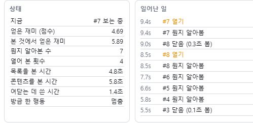

**상태 표 읽기**

| 표시 | 뜻 | 이렇게 써 보세요 |
|---|---|---|
| 지금 | `목록 보는 중`, `#번호 보는 중`, `여닫는 중` 중 현재 상태입니다. | 카드를 열거나 닫을 때 상태가 바뀌는지 확인합니다. |
| 얻은 재미 (점수) | 시청으로 얻은 재미에서 지금까지의 매 스텝 비용을 뺀 점수입니다. | 바로 위 누적 점수 그래프의 끝과 비교합니다. |
| 본 것에서 얻은 재미 | 지금까지 실제로 본 모든 콘텐츠에서 얻은 재미의 합입니다. 비용을 빼기 전 값입니다. | `얻은 재미 (점수)`와의 차이를 봅니다. |
| 뭔지 알아본 수 | 썸네일을 보고 무엇인지 알아낸 콘텐츠 수입니다. 아직 열지 않은 것도 포함합니다. | `뭔지 알아봄` 기록이 생길 때 숫자가 늘어나는지 봅니다. |
| 열어 본 횟수 | 콘텐츠를 연 횟수입니다. 같은 콘텐츠를 다시 열어도 한 번 더 셉니다. | `#번호 열기` 기록과 함께 확인합니다. |
| 목록을 본 시간 | 목록에서 스크롤하거나 멈춰서 살펴본 시간의 합입니다. | 목록을 내리는 동안 값이 늘어나는지 봅니다. |
| 콘텐츠를 본 시간 | 콘텐츠를 실제로 시청한 시간의 합입니다. 여닫는 시간은 제외합니다. | 콘텐츠를 연 뒤 이 값이 늘어나는지 봅니다. |
| 여닫는 데 쓴 시간 | 콘텐츠를 열고 목록으로 돌아오는 전환에 쓴 시간의 합입니다. | 자주 열고 닫을수록 얼마나 늘어나는지 봅니다. |
| 방금 한 행동 | 가장 최근 한 스텝의 행동입니다. `아래로`, `위로`, `멈춤`, `1번 카드 열기`, `닫고 목록으로` 등이 나옵니다. | **한 스텝 (N)**을 누르며 읽습니다. 시청 중 `멈춤`은 영상을 계속 보는 행동입니다. |

위 캡처에서 점수는 **4.69**, 본 것에서 얻은 재미는 **5.89**입니다. 기본 설정에서는 0.1초마다 비용 0.01이 들어, 12초 동안 쌓인 비용 **1.20**만큼 차이가 납니다. 세 가지 시간도 **4.8 + 5.8 + 1.4 = 12.0초**로 세션 경과 시간과 같습니다.

**일어난 일 읽기**

기록은 **최근 일이 맨 위**에 나옵니다. 왼쪽의 `6.1s` 같은 숫자는 세션 시작 후 몇 초에 일어났는지를 뜻합니다. 기록이 길어지면 이 영역 안에서 스크롤해 이전 내용을 볼 수 있습니다. 화면에는 최근 최대 60개가 표시됩니다.

| 표시 | 뜻 | 이렇게 써 보세요 |
|---|---|---|
| `#번호 뭔지 알아봄` | 콘텐츠가 무엇인지 알아낸 순간입니다. 알아봤다고 바로 여는 것은 아닙니다. | 같은 번호의 `열기` 기록이 뒤이어 생기는지 확인합니다. |
| **노란 배경**의 `지나간 뒤에 뒤늦게!` | 목록에서 지나간 콘텐츠를 화면 밖에서 뒤늦게 알아챘습니다. | `늦은 깨달음` 탭에서 해당 번호를 기억하고 다음 행동을 봅니다. |
| **주황 글씨**의 `#번호 열기` | 그 콘텐츠를 여는 행동입니다. | 상태 표의 `열어 본 횟수`가 늘어나는지 확인합니다. |
| `← 뒤늦게 알아챈 콘텐츠로 되돌아옴` | 지나친 뒤 알아챈 콘텐츠로 돌아와 열었습니다. | 앞선 노란 기록과 콘텐츠 번호를 맞춰 봅니다. |
| `(다시 보기)` | 실제로 본 적 있는 콘텐츠를 다시 열었습니다. | 단순히 지나쳤다가 처음 여는 경우와 구분합니다. |
| `#번호 닫음 (…초 봄)` | 콘텐츠를 닫는 행동입니다. 괄호는 해당 콘텐츠의 누적 시청 시간입니다. | 같은 콘텐츠를 여러 번 봤다면 이전 시청 시간도 포함됨을 기억합니다. |
| 빨간 글씨의 `지금은 … 할 수 없어 멈춤` | 현재 상태에서 할 수 없는 행동을 요청해 `멈춤`으로 처리했습니다. | 직접 조작할 때 현재 상태와 선택 가능한 카드를 확인합니다. |

`#3`은 피드 안의 콘텐츠 번호입니다. `방금 한 행동`의 `1번 카드 열기`는 **현재 화면에 붙은 조작 번호**이므로 두 숫자가 달라도 정상입니다. 일어난 일에는 주요 사건만 기록되며, 매 스텝의 스크롤이나 멈춤이 모두 나오지는 않습니다.

**늦은 깨달음 예시**

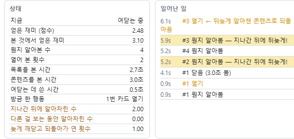

이 장면은 `늦은 깨달음` 탭에서 상황을 `아까 그거 괜찮았는데 (늦은 깨달음) [확장]`으로 고른 결과입니다. 이 상황은 **지나간 뒤에도 생각나는 시간**을 `0 → 2초`로 바꿉니다. 위쪽 주황 기록은 **6.1초에 #3을 열었음**, 그 아래 노란 기록은 **5.9초에 #3을 뒤늦게 알아챘음**을 보여 줍니다.

이 탭의 상태 표에는 다음 세 줄이 추가됩니다. 다른 확장 탭에서는 해당 기능의 지표가 추가될 수 있습니다.

| 추가 표시 | 뜻 | 이렇게 써 보세요 |
|---|---|---|
| 지나간 뒤에 알아차린 수 | 스크롤로 지나친 뒤 화면 밖에서 알아챈 콘텐츠 수입니다. | 노란 기록의 서로 다른 콘텐츠 번호를 세어 봅니다. |
| 다른 걸 보는 동안 알아차린 수 | 콘텐츠를 시청하거나 여닫느라 목록이 가려진 동안 알아챈 콘텐츠 수입니다. | 해당 처리가 켜져 있을 때 관찰합니다. 위 캡처에서는 `0.00`입니다. |
| 늦게 깨닫고 되돌아가 연 횟수 | 지나친 뒤 알아챈 콘텐츠를 연 횟수입니다. | `되돌아옴`이 붙은 주황 기록과 비교합니다. |

**이렇게 써 보세요**: 아래 주소로 6.2초 장면을 연 뒤 노란 줄과 주황 글씨의 `#3`을 비교하세요. **한 스텝 (N)**으로 진행하면 `여닫는 중`에서 `#3 보는 중`으로 바뀌는 과정도 볼 수 있습니다. 정책은 `greedy`, ρ는 `0.6`, seed는 `10000`, dwell은 `0.5`이며 `greedy`에서는 dwell을 사용하지 않습니다.

```text
http://127.0.0.1:8000/b/3/?scenario=late&policy=greedy&seed=10000&rho=0.6&dwell=0.5&skip=62&hidden=0&pause=0
```

**알아 두면 좋은 점**: 상태 표는 현재 피드 한 번의 진행 수치입니다. 아래쪽 `행동 비교`의 여러 피드 평균과 구분하세요. **다시 시작 (R)**을 누르면 상태 수치와 사건 기록도 처음부터 시작합니다.

### 3.5 아래쪽: 행동 비교

**행동 비교** — 기본 설정과 현재 설정의 행동 차이를 숫자와 막대로 확인하는 곳입니다.

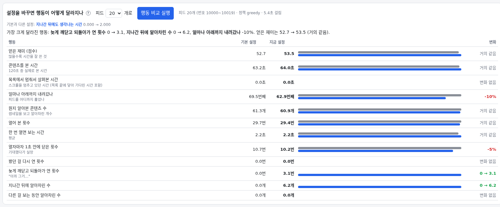

| 표시 | 뜻 | 이렇게 써 보세요 |
|---|---|---|
| 피드 10·20·30개로 | 비교에 사용할 피드 개수 | 20개 선택 → ‘행동 비교 실행’ |
| 행동 비교 실행 | 기본·현재 설정의 평균 결과 계산 | ⚙ 설정에서 값을 바꾼 뒤 클릭 |
| 기본과 다른 설정 | 바꾼 설정의 이름과 변경 전후 값 | ‘지나간 뒤에도 생각나는 시간’이 0 → 2초인지 확인 |
| 기본 설정 / 회색 막대 | 기본 설정의 평균 결과 | 같은 행의 파란 막대와 비교 |
| 지금 설정 / 파란 막대 | 현재 설정의 평균 결과 | 설정 변경 후 다시 실행 → 파란 막대의 변화를 회색 막대와 비교 |
| 변화 | 기본 설정 대비 증가·감소 | `0 → 3.1`은 새로 생긴 행동, `-10%`는 약 10% 감소로 읽기 |
| 가장 크게 달라진 행동 | 변화가 큰 항목 요약 | 요약에 나온 행동을 아래 표에서 찾아 수치 확인 |

**사용 예시**

1. [늦은 깨달음 예시 장면](http://127.0.0.1:8000/b/3/?scenario=late&policy=greedy&rho=0.6&dwell=0.5&seed=10000&skip=112&speed=10&hidden=0&pause=0&autoplay=0)을 엽니다. 상황 적용과 행동 비교가 자동으로 실행됩니다.
2. 계산이 끝나면 화면 아래로 내려갑니다. **피드 20개, 번호 10000~10019, 정책 greedy**인지 확인합니다.
3. 아래 두 행을 비교합니다.

| 행동 | 기본 설정 → 지금 설정 | 읽는 방법 |
|---|---|---|
| 늦게 깨닫고 되돌아가 연 횟수 | 0.0번 → 3.1번 | 지나친 콘텐츠로 돌아가 여는 행동이 생김 |
| 얼마나 아래까지 내려갔나 | 69.5번째 → 62.9번째 | 피드를 내려간 범위가 약 10% 감소 |

**알아 두면 좋은 점:** 결과는 화면의 진행 시간과 별개로, 여러 피드를 세션 끝까지 실행한 평균입니다. 두 조건에는 같은 정책·ρ·dwell 값을 사용합니다. 막대 길이는 같은 행 안에서 비교하며, 증가·감소가 곧 좋고 나쁨을 뜻하지는 않습니다.

### 3.6 ⚙ 설정 서랍

**⚙ 설정 서랍** — 위쪽 막대에 없는 모델의 모든 설정을 한 곳에서 보고 바꾸는 곳입니다. 위쪽 막대의 **⚙ 설정**을 누르면 열리고, `닫기 ✕`나 `Esc`로 닫습니다.

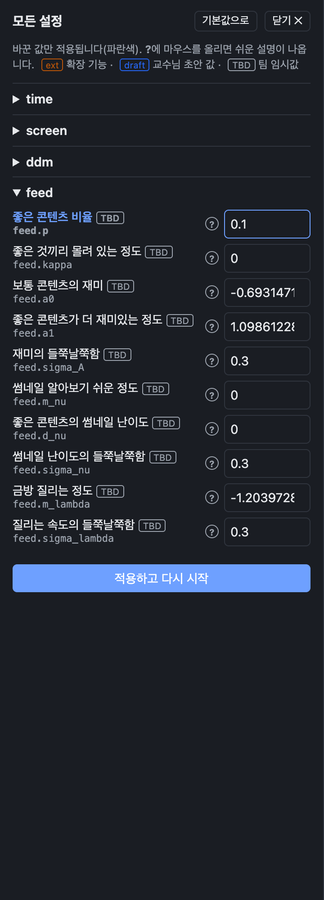

| 표시 | 뜻 | 이렇게 써 보세요 |
|---|---|---|
| time / screen / ddm / feed 묶음 | 설정이 종류별로 접혀 있습니다. 제목을 누르면 펼쳐집니다. 확장 설정이 있는 묶음(해당 브랜치에서만 보임)은 처음부터 펼쳐져 있습니다. | 피드의 성질이 궁금하면 `feed`, 썸네일 알아보기가 궁금하면 `ddm`을 펼치세요. |
| 쉬운 이름과 코드 이름 | 줄마다 위에는 쉬운 이름(예: 좋은 콘텐츠 비율), 아래에 코드 이름(예: `feed.p`)이 있습니다. 코드 이름은 `src/scrolling_agent/config.py`의 이름과 같아서, 글이나 커밋에서 설정을 가리킬 때 씁니다. | `?`에 마우스를 올리면 쉬운 설명과 config.py의 원래 주석이 나옵니다. |
| `ext` / `draft` / `TBD` 꼬리표 | `ext` 확장 기능(그 브랜치에만 있고 기본값 꺼짐) · `draft` 교수님 초안에서 정한 값 · `TBD` 팀이 임시로 정한 값입니다. | `draft` 값은 초안과의 약속이니 실험으로만 바꾸고, 바꾼 채 공유하지는 마세요. |
| 파란색 줄 | 기본값과 다르게 **바꾼 값**입니다. 바꾼 값만 적용됩니다. | 위쪽 막대에서 상황을 고른 뒤 서랍을 열면, 그 상황이 무엇을 바꿨는지 파란 줄로 확인할 수 있습니다. |
| 적용하고 다시 시작 | 바꾼 값을 적용하고 처음부터 다시 돌립니다. 서랍에서 값만 바꾸고 이 버튼을 누르지 않으면 행동은 그대로입니다. | 값을 바꿨으면 반드시 이 버튼(또는 막대의 다시 시작)까지 누르세요. |
| 기본값으로 | 모든 칸을 기본값으로 되돌립니다(파란 표시가 사라짐). 되돌린 뒤에도 `적용하고 다시 시작`을 눌러야 실제로 반영됩니다. | 이것저것 바꾸다 꼬였을 때 누르고 다시 시작하면 처음 상태가 됩니다. |

**알아 두면 좋은 점**: 여기서 바꾼 값은 아래 행동 비교(3.5)의 "기본과 다른 설정" 줄에도 그대로 나오므로, 무엇을 바꿨는지 숫자 비교와 함께 기록됩니다.
설정 목록은 지금 돌고 있는 브랜치 기준이라, 확장 설정(예: `estimate.*`)은 그 확장이 있는 탭에서만 보입니다.

### 3.7 직접 해 보기 (human 모드)
> **직접 해 보기 (human 모드)** — 맨 위 "누가 조작?"을 human으로 바꾸면 내가 키보드로 직접 휴대폰을 조작합니다
>
> 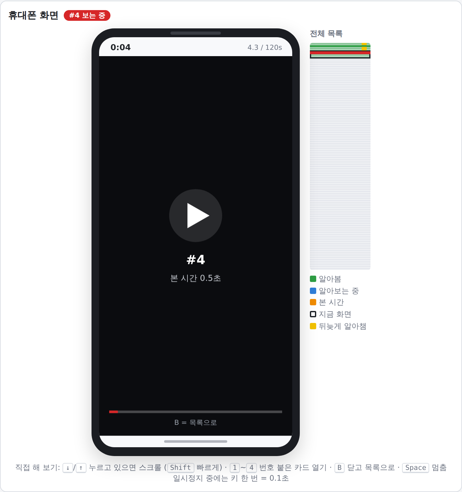
>
> | 키 | 하는 일 | 이렇게 써 보세요 |
> |---|---|---|
> | ↓ / ↑ (누르고 있기) | 아래로 / 위로 스크롤 | ↓를 길게 눌러 카드를 빠르게 지나가 보고, 파란 막대가 얼마나 차는지 보기 |
> | Shift + ↓ / ↑ | 빠르게 스크롤 | ⚙ 설정의 "스크롤 속도"를 `0.5, 1.5`처럼 두 개로 넣어야 동작 (하나면 Shift 효과 없음) |
> | 1 ~ 4 | 번호 동그라미가 붙은 카드 열기 | 초록 동그라미만 열림. 회색 카드 번호를 누르면 "일어난 일"에 "할 수 없어 멈춤"이 남음 |
> | B | 보던 콘텐츠 닫고 목록으로 | "지금 재미"가 볼 만한 기준 아래로 떨어지면 닫아 보기 |
> | Space | 멈춤 (가만히 화면 보기) | 스크롤 없이 멈춰 있으면 화면 속 카드를 더 빨리 알아봄 |
>
> - **재생 중**에는 키를 누르는 동안 시간이 흘러가며 계속 움직입니다.
> - **일시정지 중**(P)에는 키 한 번 = 0.1초 한 칸입니다. 중요한 장면을 천천히 만들 때 씁니다.
>
> **늦은 깨달음 직접 만들어 보기**
>
> 1. 위쪽 탭에서 **늦은 깨달음**을 고르고, 상황은 "아까 그거 괜찮았는데"를 고릅니다.
> 2. 누가 조작?을 **human**으로 바꾸고 재생(P)합니다.
> 3. ↓를 계속 눌러 카드들을 다 알아보기 전에 화면 밖으로 지나가게 합니다.
> 4. 조금 뒤 "일어난 일"에 노란 줄 "— 지나간 뒤에 뒤늦게!"가 뜨고, 지도에 노란 표시가 생깁니다.
> 5. ↑로 그 카드까지 되돌아가 번호 키로 엽니다. "뒤늦게 알아챈 콘텐츠로 되돌아옴"이 남으면 성공입니다.
>
> **알아 두면 좋은 점**: 기본 모델 탭에서는 화면 밖으로 나간 카드를 더 이상 알아보지 않기 때문에 늦은 깨달음이 생기지 않습니다. human 모드에서는 주소의 `skip=`가 동작하지 않습니다.

### 3.8 비교 페이지의 탭과 맨 위 줄

**비교 페이지** — 모델을 탭으로 바꿔 보고, 공통 조건으로 함께 시작·재생하는 곳입니다.

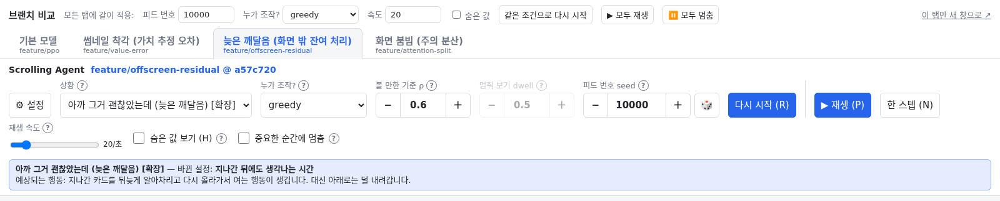

| 표시 | 뜻 | 이렇게 써 보세요 |
|---|---|---|
| 모델 탭 | 화면에 표시할 모델 선택 | ‘기본 모델’ ↔ ‘늦은 깨달음’ 전환 |
| 피드 번호 | 모든 탭에 사용할 피드 번호 | `10000` 입력 → ‘같은 조건으로 다시 시작’ |
| 누가 조작? | 모든 탭의 조작 방식 | `greedy` 선택 → ‘같은 조건으로 다시 시작’ |
| 속도 | 시뮬레이션의 재생 빠르기 | `10 → 20`으로 변경 → ‘모두 재생’으로 두 배 빠르게 관찰 |
| 숨은 값 | 콘텐츠의 실제 정보 표시 | 체크 → ‘모두 멈춤’ → 카드에 표시된 실제 재미 확인 |
| 같은 조건으로 다시 시작 | 공통 조건 적용 후 처음부터 시작 | 피드 번호·정책을 바꾼 뒤 클릭 |
| ▶ 모두 재생 / ⏸ 모두 멈춤 | 전체 탭 재생·정지 | 모두 재생 → 모두 멈춤 → 탭을 바꾸며 상태 비교 |
| 이 탭만 새 창으로 ↗ | 선택한 모델을 별도 창으로 열기 | ‘늦은 깨달음’ 탭 선택 후 클릭 |

**사용 예시**

1. [비교 페이지](http://127.0.0.1:8000/#3)를 엽니다.
2. **기본 모델** 탭에서 상황을 **‘기본 (교수님 초안 설정)’**으로 고릅니다.
3. **늦은 깨달음** 탭에서 **‘아까 그거 괜찮았는데 (늦은 깨달음) [확장]’**를 고릅니다. 두 탭의 **ρ는 0.6**으로 맞춥니다.
4. 맨 위 줄을 **피드 번호 10000 · 정책 greedy · 속도 20 · 숨은 값 꺼짐**으로 맞춥니다.
5. **‘같은 조건으로 다시 시작’ → ‘▶ 모두 재생’** 순서로 누릅니다.
6. 잠시 뒤 **‘⏸ 모두 멈춤’**을 누릅니다. 두 탭을 번갈아 보며 뒤늦게 알아챈 표시와 되돌아가는 행동을 살펴봅니다.

**알아 두면 좋은 점:** 공통 조작은 피드 번호·정책·재생 속도·숨은 값에 적용됩니다. 각 탭의 상황·확장 설정·ρ·dwell은 유지되므로 따로 맞춰 주세요. 이 예시의 `greedy`에서는 dwell 값을 사용하지 않습니다.

---

## 4. 이 문서에 추가하는 방법

### 4.1 화면 캡처하기

1. 2.1처럼 데모를 실행하고, 보여 주고 싶은 장면을 만듭니다. 2.5의 주소(`skip=`, `scenario=`)를 쓰면 같은 장면을 다시 만들기 쉽습니다.
2. **`Win + Shift + S`** → 사각형으로 원하는 부분을 선택 → 오른쪽 아래 알림을 눌러 **저장**(PNG).
3. 파일을 `docs/guide/images/`에 넣습니다.
   - 이름은 **절 번호 + 짧은 영어**: `31-controls.png`, `32-phone-card.png`, `35-compare-table.png`
   - 너무 크면 읽기 힘드니 화면 일부만 잘라 주세요(가로 1600픽셀 이하 권장).
4. 문서에는 `` 한 줄로 넣습니다. 설명은 그림이 안 보일 때 대신 읽히는 문장입니다.
5. 화살표나 번호를 그려 넣고 싶으면 캡처 도구(또는 그림판)에서 그린 뒤 저장하면 됩니다. 원본과 표시본을 구분하려면 `-annotated`를 붙입니다.

### 4.2 쓰는 규칙

- **쉬운 말**로 씁니다. 화면에 보이는 이름 그대로("볼 만한 기준", "알아봄") 쓰고, 전문용어(DDM, drift, λ)는 피합니다. 꼭 필요하면 괄호로 한 번만.
- 한 문장에 정보 하나. 표가 더 읽기 쉬우면 표로.
- "이렇게 써 보세요"처럼 **직접 해 볼 수 있는 한 가지**를 꼭 넣습니다(무엇을 바꾸고 무엇을 보면 되는지).
- 화면 문구나 기능이 바뀌면 해당 절의 캡처도 함께 바꿉니다.

### 4.3 올리는 방법 (Git)

```powershell
git switch feature/user-guide
git pull
git switch -c docs/guide-3-2-phone          # 내 작업용 브랜치 (절 번호와 내용)

# docs/guide/README.md 수정, images/에 캡처 추가
git add docs/guide
git commit -m "Guide: describe the phone screen (3.2)"
git push -u origin docs/guide-3-2-phone
```

그다음 GitHub에서 **Pull Request**를 `feature/user-guide`로 만들고, 표의 "담당"과 "상태"를 고쳐 주세요(작성 필요 → 작성됨).
여러 사람이 같은 파일을 고치므로, **자기 절만** 고치면 충돌이 거의 나지 않습니다.

### 4.4 PDF가 필요할 때

문서 원본은 이 md 파일 하나로 두고, 제출·인쇄용 PDF는 그때그때 만듭니다.

- **VS Code**: 확장 "Markdown PDF"(yzane) 설치 → 이 파일을 연 상태에서 `Ctrl + Shift + P` → **Markdown PDF: Export (pdf)**
- **브라우저**: GitHub에서 이 파일을 연 뒤 `Ctrl + P` → "PDF로 저장"
