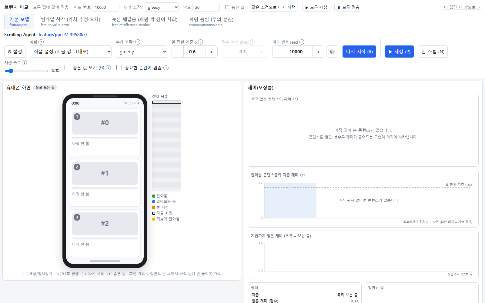
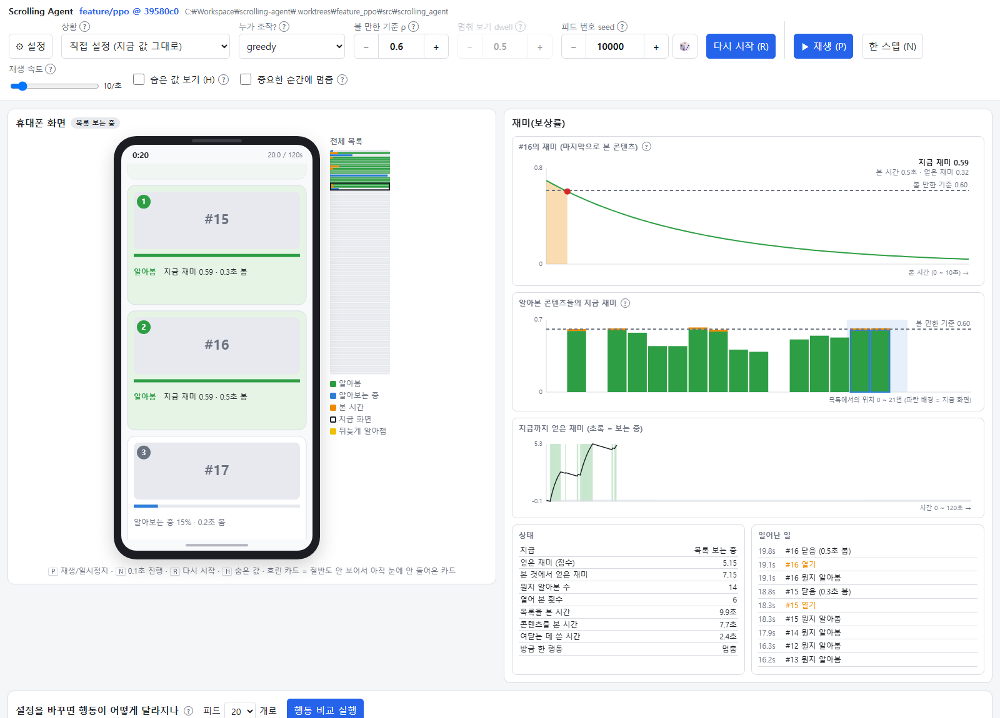
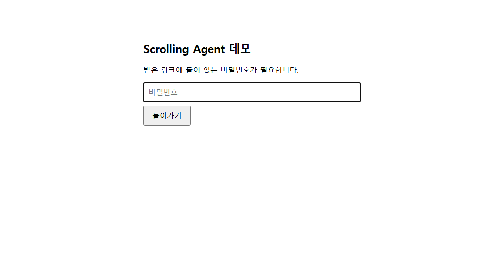
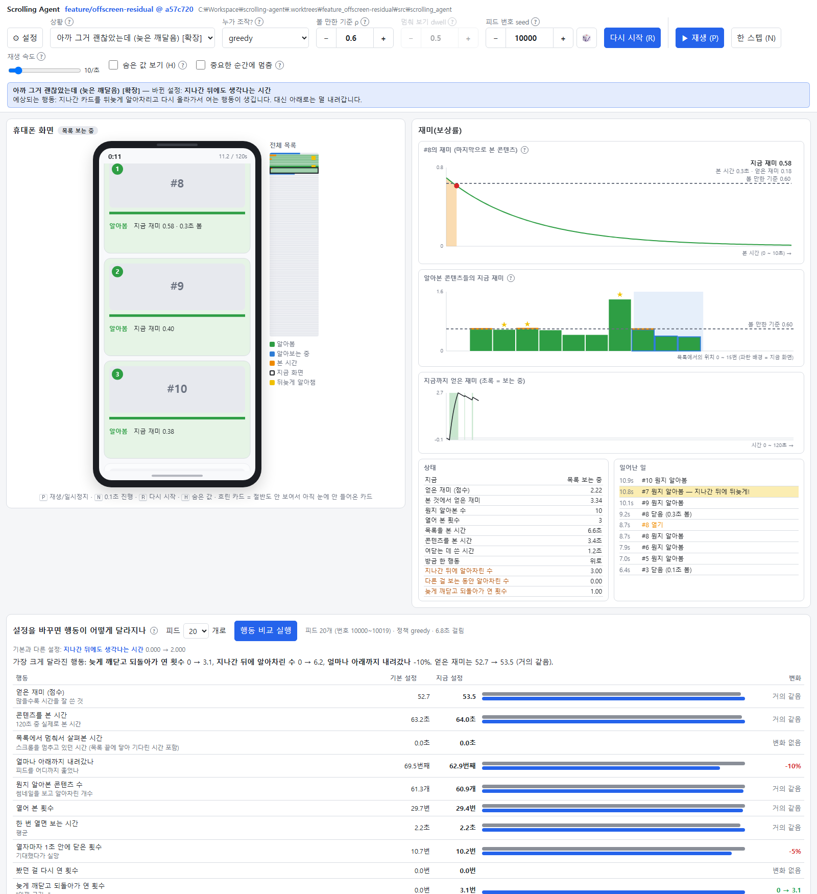
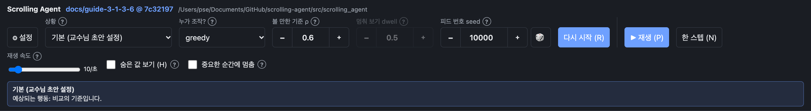
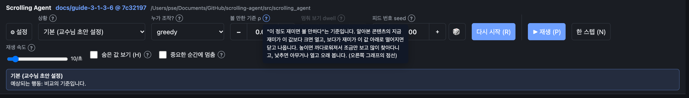
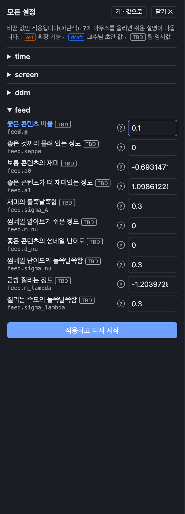

# Scrolling Agent 웹 데모 사용 가이드

브라우저에서 스크롤 에이전트가 피드를 넘기고, 알아보고, 열어 보는 모습을 실시간으로 보고 직접 조작해 보는 도구의 사용 설명서입니다.

| 장 | 내용 | 상태 | 작성 |
|---|---|---|---|
| 1 | 처음 한 번 준비하기 | 작성됨 | 박준호 |
| 2 | 실행하고 페이지 열기 | 작성됨 | 박준호 |
| 3 | 화면 각 부분의 역할 | **작성 필요** | 팀원 (3장 표에 이름 적기) |
| 4 | 이 문서에 추가하는 방법 | 작성됨 | 박준호 |

> 처음 보는 분은 1장 → 2장 순서대로 따라 하면 됩니다. 3장을 쓰실 분은 4장을 먼저 읽어 주세요.

---

## 1. 처음 한 번 준비하기

Windows PowerShell 기준입니다. VS Code에서 **터미널 → 새 터미널**(`` Ctrl + ` ``)을 열고 순서대로 실행합니다.

```powershell
# 1) 코드 받기 (처음 한 번)
git clone https://github.com/jznpark/scrolling-agent.git C:\Workspace\scrolling-agent
cd C:\Workspace\scrolling-agent
git switch feature/web-demo

# 2) 가상환경 만들고 설치 (처음 한 번, 몇 분 걸림)
python -m venv .venv
.\.venv\Scripts\Activate.ps1
pip install -e ".[dev]"

# 3) 잘 설치됐는지 확인 — 마지막 줄에 "passed"가 나오면 성공
pytest
```

- 새 터미널을 열 때마다 `.\.venv\Scripts\Activate.ps1`을 다시 실행해야 합니다. 줄 앞에 `(.venv)`가 보이면 켜진 상태입니다.
- `Activate.ps1`에서 "스크립트를 실행할 수 없습니다" 오류가 나면 먼저 아래를 실행하세요.
  ```powershell
  Set-ExecutionPolicy -Scope Process -ExecutionPolicy RemoteSigned
  ```
- 이미 받아 둔 경우에는 최신으로만 바꾸면 됩니다: `git switch feature/web-demo` → `git pull`

---

## 2. 실행하고 페이지 열기

### 2.1 내 PC에서 실행하기

```powershell
cd C:\Workspace\scrolling-agent
.\.venv\Scripts\Activate.ps1
python scripts\serve_branches.py --open
```

터미널에 아래처럼 나오면 실행된 것입니다. `--open`을 붙이면 브라우저가 자동으로 열립니다.

```text
  /b/1/  feature/ppo @ 39580c0
  /b/2/  feature/value-error @ 3a53ef7
  /b/3/  feature/offscreen-residual @ a57c720
  /b/4/  feature/attention-split @ 445b875
Comparison page: http://127.0.0.1:8000  - Ctrl+C to stop all
```

- 자동으로 안 열리면 브라우저 주소창에 **http://127.0.0.1:8000** 을 입력합니다.
- 이 터미널은 **켜 둔 채로** 두어야 페이지가 동작합니다. 끌 때는 터미널에서 `Ctrl + C`.
- 브랜치 하나만 빠르게 보고 싶으면 `python scripts\serve.py --open` (지금 선택된 브랜치만, 탭 없음).

### 2.2 페이지 열기 — 탭으로 모델 고르기



- **위쪽 탭**을 누르면 화면이 통째로 바뀝니다. 탭마다 다른 모델(브랜치)입니다.

  | 탭 | 무엇이 다른가 |
  |---|---|
  | 기본 모델 | 교수님 초안 그대로 |
  | 썸네일 착각 | 썸네일만 보고 재미를 잘못 짐작함 |
  | 늦은 깨달음 | 지나간 카드를 뒤늦게 알아차리고 되돌아감 |
  | 화면 붐빔 | 화면에 모르는 카드가 많으면 알아보기가 느려짐 |

- **맨 위 줄**(피드 번호, 누가 조작?, 속도, 같은 조건으로 다시 시작, 모두 재생/멈춤)은 **모든 탭에 한꺼번에** 적용됩니다. 같은 조건에서 모델끼리 비교할 때 씁니다.
- 탭 하나만 크게 보려면 오른쪽 위 **이 탭만 새 창으로 ↗**.
- 주소 끝에 `#3`을 붙이면 세 번째 탭이 바로 열립니다: `http://127.0.0.1:8000/#3`

탭 안의 화면은 이렇게 생겼습니다(기본 모델, 20초 진행 후). 각 부분의 역할은 3장에서 설명합니다.



### 2.3 같은 와이파이(같은 공유기)의 다른 PC에서 열기

```powershell
python scripts\serve_branches.py --host 0.0.0.0
```

- 터미널에 `same network: http://192.168.x.x:8000` 주소가 나옵니다. 다른 PC 브라우저에서 이 주소로 엽니다.
- 처음 한 번은 **관리자 권한 PowerShell**에서 방화벽을 열어야 합니다.
  ```powershell
  New-NetFirewallRule -DisplayName "scrolling-agent demo" -Direction Inbound -Protocol TCP -LocalPort 8000 -Action Allow -Profile Private,Domain
  ```
- 실행할 때 "Python 액세스 허용" 창이 뜨면 **개인 네트워크**만 체크하고 허용합니다.
- `192.168.…` 주소는 **같은 공유기 안에서만** 열립니다. 다른 곳에 있는 팀원은 2.4를 쓰세요. 학교 와이파이도 기기끼리 연결을 막는 경우가 많아 2.4가 필요합니다.

### 2.4 다른 곳에 있는 팀원에게 링크로 공유하기 (Cloudflare 터널)

터미널 두 개가 필요합니다. VS Code 터미널 패널의 **`+`**(또는 `` Ctrl + Shift + ` ``)로 하나 더 엽니다.

```powershell
# 처음 한 번: 터널 프로그램 설치 (설치 후에는 새 터미널을 열어야 인식됩니다)
winget install --id Cloudflare.cloudflared

# 터미널 1: 비밀번호를 걸고 실행
python scripts\serve_branches.py --token 우리팀비번

# 터미널 2: 터널 열기 (venv 필요 없음)
cloudflared tunnel --url http://localhost:8000
```

터미널 2에 이런 상자가 나오면 그 주소가 외부 공개 주소입니다.

```text
|  Your quick Tunnel has been created! Visit it at (it may take some time to be reachable):  |
|  https://xxxx-xxxx-xxxx-xxxx.trycloudflare.com                                             |
```

팀원에게는 **비밀번호를 붙인 주소**를 보냅니다.

```text
https://xxxx-xxxx-xxxx-xxxx.trycloudflare.com/?token=우리팀비번
```

비밀번호 없이 들어오면 아래 화면이 나옵니다. 비밀번호를 넣고 **들어가기**를 누르면 됩니다(한 번 들어오면 브라우저가 기억).



- 터미널 1, 2를 **둘 다 켜 둬야** 접속됩니다. 끄면 바로 닫힙니다.
- 터널을 다시 켜면 **주소가 바뀝니다** → 새 주소를 다시 공유하세요.
- 처음 1분 정도는 접속이 안 될 수 있습니다. 잠시 후 새로고침.
- `--token` 없이 열면 링크를 아는 누구나 들어올 수 있으니 꼭 비밀번호를 거세요.

### 2.5 주소로 원하는 상태를 바로 열기

공유할 때 "이 장면을 봐" 하고 보내기 좋습니다. 탭 안의 화면 주소(`/b/번호/`) 뒤에 붙입니다.

| 붙이는 것 | 뜻 | 예 |
|---|---|---|
| `scenario=상황이름` | 상황 고르기를 적용하고 행동 비교까지 실행 | `scenario=late` (늦은 깨달음), `scenario=boring_fast` (금방 질림) |
| `skip=숫자` | 그만큼(0.1초 단위) 진행한 장면부터 | `skip=112` → 11.2초 |
| `policy=이름` | 누가 조작할지 | `policy=human` (직접 해 보기) |
| `seed=숫자` | 피드 번호 | `seed=10003` |
| `hidden=1` | 숨은 값 보기 켜기 | |
| `pause=1` | 중요한 순간에 멈춤 켜기 | |
| `autoplay=1` | 열자마자 재생 | |

예: 늦은 깨달음 탭에서 11.2초 장면

```text
http://127.0.0.1:8000/b/3/?scenario=late&skip=112
```



상황 이름 목록은 `webdemo/descriptions.py`의 `SCENARIOS`에 있습니다.

### 2.6 자주 나는 문제

| 증상 | 원인과 해결 |
|---|---|
| `cloudflared`(이)가 인식되지 않습니다 | 설치 안 됨 → `winget install --id Cloudflare.cloudflared` 후 **새 터미널**에서 실행 |
| `Activate.ps1` 실행 오류 | `Set-ExecutionPolicy -Scope Process -ExecutionPolicy RemoteSigned` 후 다시 |
| `[WinError 10048] 각 소켓 주소(…)는 하나만 사용할 수 있습니다` 또는 `server for … stopped` | 이미 서버가 켜져 있음(포트 사용 중) → 켜져 있는 터미널에서 `Ctrl + C`, 또는 `--port 8100`처럼 다른 번호로 실행 |
| 비밀번호 화면이 계속 나옴 | 주소의 `?token=` 값이 터미널 1의 `--token` 값과 다름 |
| 탭 안이 하얗게 비어 있음 | 터미널 1이 꺼졌거나 아직 시작 중 → 터미널 확인 후 새로고침 |
| 다른 PC에서 안 열림 | 같은 공유기가 아니면 2.3이 아니라 2.4(터널)를 써야 함 |

---

## 3. 화면 각 부분의 역할 — 팀원 작성 부분

> **이 장은 팀원들이 나눠서 채웁니다.** 맡을 칸의 "담당"에 이름을 적고, 4장의 방법대로 캡처와 설명을 넣어 주세요.
> 각 칸 아래의 `<!-- TODO -->`를 지우고 그 자리에 씁니다. 3.0의 작성 예시 형식을 따라 주세요.

| 절 | 화면 부분 | 담당 | 상태 |
|---|---|---|---|
| 3.1 | 위쪽 조작 막대 (상황, 누가 조작?, 볼 만한 기준, 멈춰 보기, 피드 번호, 재생) | 세은 | 작성됨 |
| 3.2 | 왼쪽: 휴대폰 화면과 전체 목록 지도 | | 작성 필요 |
| 3.3 | 오른쪽: 재미 그래프 3개 | | 작성 필요 |
| 3.4 | 상태 표와 일어난 일 | | 작성 필요 |
| 3.5 | 아래쪽: 행동 비교 | | 작성 필요 |
| 3.6 | ⚙ 설정 서랍 (모든 설정, `?` 설명) | 세은 | 작성됨 |
| 3.7 | 직접 해 보기 (human 모드 키 조작) | | 작성 필요 |
| 3.8 | 비교 페이지의 탭과 맨 위 줄 | | 작성 필요 |

### 3.0 작성 예시 (형식 참고용 — 실제 3.x를 쓸 때 이 모양으로)

> **화면 부분 이름** — 한 줄로 무엇을 하는 곳인지
>
> 
>
> | 표시 | 뜻 | 이렇게 써 보세요 |
> |---|---|---|
> | 볼 만한 기준 ρ | 이 정도 재미면 볼 만하다는 기준 | ＋를 눌러 0.9로 올리고 재생 → 조금 보고 자주 닫는지 관찰 |
>
> **알아 두면 좋은 점**: 한두 줄

### 3.1 위쪽 조작 막대

**위쪽 조작 막대** — 무엇을(상황·피드), 누가(정책), 어떤 기준으로(ρ·dwell) 돌릴지 정하고, 재생을 조종하는 곳입니다.


맨 왼쪽 위에는 지금 돌고 있는 **브랜치 이름 @ 커밋**이 나옵니다. 비교 페이지라면 탭에서 고른 모델이 여기 표시됩니다.
각 칸의 `?`에 마우스를 올리면 쉬운 설명이 나옵니다.

**무엇을 돌릴지 정하는 칸**

| 표시 | 뜻 | 이렇게 써 보세요 |
|---|---|---|
| ⚙ 설정 | 모든 설정을 바꿀 수 있는 서랍을 엽니다(3.6). | 여기 없는 세부 값(질리는 속도 등)을 바꿀 때 엽니다. |
| 상황 | 자주 궁금한 상황을 고르면 관련 설정이 자동으로 바뀌고, 바로 다시 시작됩니다. 막대 아래에 **바뀐 설정**과 **예상되는 행동**이 나오고, 아래쪽 행동 비교(3.5)도 자동으로 돕니다. | `좋은 콘텐츠가 드문 피드`를 골라 보세요. 예상 글귀와 실제 행동을 맞춰 보면 됩니다. 첫 항목 `직접 설정`은 지금 값 그대로 두는 선택입니다. |
| 누가 조작? | 휴대폰을 조작할 주체입니다. `human`(내가 키보드로, 3.7) / `random` / `scrollfirst`(내리다가 처음 알아본 것 열기) / `greedy`(알아본 것 중 제일 재밌어 보이는 것 열기) / `greedy-dwell`(greedy + 모르는 카드 앞에서 잠깐 멈춤) / `ppo:이름`(학습한 인공지능). | `scrollfirst`와 `greedy`를 번갈아 돌려, 지나친 콘텐츠로 되돌아가는지가 어떻게 다른지 보세요. |
| 볼 만한 기준 ρ | "이 정도 재미면 볼 만하다"는 기준입니다. 알아본 콘텐츠의 지금 재미가 ρ보다 크면 열고, 보다가 ρ 아래로 떨어지면 닫습니다. 오른쪽 그래프의 점선이 이 값입니다(3.3). | ＋를 눌러 0.9로 올리고 **다시 시작 (R)** → 조금 보고 자주 닫는지, 0.3으로 내리면 아무거나 오래 보는지 비교하세요. |
| 멈춰 보기 dwell | `greedy-dwell`에서, 아직 뭔지 모르는 카드 앞에 최대 몇 초 멈춰 설지입니다. 다른 정책에서는 흐리게 꺼져 있습니다. | 정책을 `greedy-dwell`로 바꾸면 칸이 살아납니다. 0으로 두면 멈추지 않는 greedy와 같아집니다. |
| 피드 번호 seed | 어떤 피드(콘텐츠 목록)를 쓸지 고르는 번호입니다. 같은 번호면 언제나 같은 피드라서, 설정만 바꿔 공정하게 비교할 수 있습니다. 🎲는 무작위 번호입니다. | 캡처나 영상에 남길 장면은 seed를 적어 두세요. 같은 번호로 누구나 같은 장면을 다시 만들 수 있습니다. |

**재생을 조종하는 칸**

| 표시 | 뜻 | 이렇게 써 보세요 |
|---|---|---|
| 다시 시작 (R) | 지금 고른 상황·정책·ρ·dwell·seed·설정으로 처음(0초)부터 다시 돌립니다. **ρ, dwell, 설정 변경은 다시 시작해야 행동에 적용됩니다.** | 값을 바꿨는데 행동이 그대로면 먼저 R을 눌렀는지 확인하세요. |
| ▶ 재생 (P) | 시간이 흐르기 시작합니다. 다시 누르면 일시정지. | 일시정지 후 아래 `한 스텝`과 함께 쓰면 장면을 천천히 뜯어볼 수 있습니다. |
| 한 스텝 (N) | 한 번의 판단 간격(기본 0.5초)만큼만 진행합니다. | 콘텐츠가 열리는 순간 일시정지하고 N을 연타하며 그래프 변화를 관찰해 보세요(3.3). |
| 재생 속도 | 화면이 흘러가는 빠르기입니다. 10이 실제 속도, 100이면 10배 빠르게. | 전체 흐름은 빠르게 훑고, 궁금한 구간에서 10으로 낮추세요. |
| 숨은 값 보기 (H) | 실제로는 열어 보기 전까지 모르는 정보(진짜 재미, 좋은 콘텐츠인지)를 분석용으로 겹쳐 보여 줍니다. | 에이전트가 "놓친" 좋은 콘텐츠가 어디 있었는지 확인할 때 켭니다. |
| 중요한 순간에 멈춤 | 늦은 깨달음(지나간 카드를 뒤늦게 알아챔)이나 그 카드로 되돌아가 여는 순간에 자동으로 멈추고 안내를 띄웁니다. | `늦은 깨달음` 상황과 함께 켜 두면 결정적 장면을 놓치지 않습니다. |



**알아 두면 좋은 점**: 괄호 속 글자(R, P, N, H)는 키보드 단축키입니다. 캡처 속 `멈춰 보기 dwell`이 흐린 것은 정책이 `greedy`라 쓰이지 않기 때문입니다.
막대에서 고른 값들은 2.5의 주소(`?scenario=…&policy=…&seed=…`)로도 그대로 적을 수 있어, 같은 장면을 링크로 공유할 때 씁니다.

### 3.2 왼쪽: 휴대폰 화면과 전체 목록 지도
<!-- TODO: 카드의 번호 동그라미(1~4), 파란 막대(알아보는 중), 초록(알아봄), 흐린 카드, ★ 표시, 보는 중 화면, 오른쪽 지도 색 -->

### 3.3 오른쪽: 재미 그래프 3개
<!-- TODO: (1) 보고 있는 콘텐츠의 재미 곡선과 색칠된 넓이 (2) 알아본 콘텐츠들의 지금 재미 막대와 점선 (3) 지금까지 얻은 재미 -->

### 3.4 상태 표와 일어난 일
<!-- TODO: 각 줄의 뜻, 노란 줄(뒤늦게 알아봄), 주황 글씨(열기) -->

### 3.5 아래쪽: 행동 비교
<!-- TODO: 무엇과 무엇을 비교하는지, 회색/파란 막대, 변화 칸 읽는 법, 상황 고르기와 함께 쓰는 법 (2.5의 캡처 참고) -->

### 3.6 ⚙ 설정 서랍

**⚙ 설정 서랍** — 위쪽 막대에 없는 모델의 모든 설정을 한 곳에서 보고 바꾸는 곳입니다. 위쪽 막대의 **⚙ 설정**을 누르면 열리고, `닫기 ✕`나 `Esc`로 닫습니다.



| 표시 | 뜻 | 이렇게 써 보세요 |
|---|---|---|
| time / screen / ddm / feed 묶음 | 설정이 종류별로 접혀 있습니다. 제목을 누르면 펼쳐집니다. 확장 설정이 있는 묶음(해당 브랜치에서만 보임)은 처음부터 펼쳐져 있습니다. | 피드의 성질이 궁금하면 `feed`, 썸네일 알아보기가 궁금하면 `ddm`을 펼치세요. |
| 쉬운 이름과 코드 이름 | 줄마다 위에는 쉬운 이름(예: 좋은 콘텐츠 비율), 아래에 코드 이름(예: `feed.p`)이 있습니다. 코드 이름은 `src/scrolling_agent/config.py`의 이름과 같아서, 글이나 커밋에서 설정을 가리킬 때 씁니다. | `?`에 마우스를 올리면 쉬운 설명과 config.py의 원래 주석이 나옵니다. |
| `ext` / `draft` / `TBD` 꼬리표 | `ext` 확장 기능(그 브랜치에만 있고 기본값 꺼짐) · `draft` 교수님 초안에서 정한 값 · `TBD` 팀이 임시로 정한 값입니다. | `draft` 값은 초안과의 약속이니 실험으로만 바꾸고, 바꾼 채 공유하지는 마세요. |
| 파란색 줄 | 기본값과 다르게 **바꾼 값**입니다. 바꾼 값만 적용됩니다. | 위쪽 막대에서 상황을 고른 뒤 서랍을 열면, 그 상황이 무엇을 바꿨는지 파란 줄로 확인할 수 있습니다. |
| 적용하고 다시 시작 | 바꾼 값을 적용하고 처음부터 다시 돌립니다. 서랍에서 값만 바꾸고 이 버튼을 누르지 않으면 행동은 그대로입니다. | 값을 바꿨으면 반드시 이 버튼(또는 막대의 다시 시작)까지 누르세요. |
| 기본값으로 | 모든 칸을 기본값으로 되돌립니다(파란 표시가 사라짐). 되돌린 뒤에도 `적용하고 다시 시작`을 눌러야 실제로 반영됩니다. | 이것저것 바꾸다 꼬였을 때 누르고 다시 시작하면 처음 상태가 됩니다. |

**알아 두면 좋은 점**: 여기서 바꾼 값은 아래 행동 비교(3.5)의 "기본과 다른 설정" 줄에도 그대로 나오므로, 무엇을 바꿨는지 숫자 비교와 함께 기록됩니다.
설정 목록은 지금 돌고 있는 브랜치 기준이라, 확장 설정(예: `estimate.*`)은 그 확장이 있는 탭에서만 보입니다.

### 3.7 직접 해 보기 (human 모드)
<!-- TODO: 키 조작(↓↑ Shift 1~4 B Space), 일시정지 중 한 칸씩, 늦은 깨달음을 직접 만들어 보는 방법 -->

### 3.8 비교 페이지의 탭과 맨 위 줄
<!-- TODO: 같은 조건으로 다시 시작 → 모두 재생으로 모델끼리 비교하는 순서 -->

---

## 4. 이 문서에 추가하는 방법

### 4.1 화면 캡처하기

1. 2.1처럼 데모를 실행하고, 보여 주고 싶은 장면을 만듭니다. 2.5의 주소(`skip=`, `scenario=`)를 쓰면 같은 장면을 다시 만들기 쉽습니다.
2. **`Win + Shift + S`** → 사각형으로 원하는 부분을 선택 → 오른쪽 아래 알림을 눌러 **저장**(PNG).
3. 파일을 `docs/guide/images/`에 넣습니다.
   - 이름은 **절 번호 + 짧은 영어**: `31-controls.png`, `32-phone-card.png`, `35-compare-table.png`
   - 너무 크면 읽기 힘드니 화면 일부만 잘라 주세요(가로 1600픽셀 이하 권장).
4. 문서에는 `` 한 줄로 넣습니다. 설명은 그림이 안 보일 때 대신 읽히는 문장입니다.
5. 화살표나 번호를 그려 넣고 싶으면 캡처 도구(또는 그림판)에서 그린 뒤 저장하면 됩니다. 원본과 표시본을 구분하려면 `-annotated`를 붙입니다.

### 4.2 쓰는 규칙

- **쉬운 말**로 씁니다. 화면에 보이는 이름 그대로("볼 만한 기준", "알아봄") 쓰고, 전문용어(DDM, drift, λ)는 피합니다. 꼭 필요하면 괄호로 한 번만.
- 한 문장에 정보 하나. 표가 더 읽기 쉬우면 표로.
- "이렇게 써 보세요"처럼 **직접 해 볼 수 있는 한 가지**를 꼭 넣습니다(무엇을 바꾸고 무엇을 보면 되는지).
- 화면 문구나 기능이 바뀌면 해당 절의 캡처도 함께 바꿉니다.

### 4.3 올리는 방법 (Git)

```powershell
git switch feature/user-guide
git pull
git switch -c docs/guide-3-2-phone          # 내 작업용 브랜치 (절 번호와 내용)

# docs/guide/README.md 수정, images/에 캡처 추가
git add docs/guide
git commit -m "Guide: describe the phone screen (3.2)"
git push -u origin docs/guide-3-2-phone
```

그다음 GitHub에서 **Pull Request**를 `feature/user-guide`로 만들고, 표의 "담당"과 "상태"를 고쳐 주세요(작성 필요 → 작성됨).
여러 사람이 같은 파일을 고치므로, **자기 절만** 고치면 충돌이 거의 나지 않습니다.

### 4.4 PDF가 필요할 때

문서 원본은 이 md 파일 하나로 두고, 제출·인쇄용 PDF는 그때그때 만듭니다.

- **VS Code**: 확장 "Markdown PDF"(yzane) 설치 → 이 파일을 연 상태에서 `Ctrl + Shift + P` → **Markdown PDF: Export (pdf)**
- **브라우저**: GitHub에서 이 파일을 연 뒤 `Ctrl + P` → "PDF로 저장"
