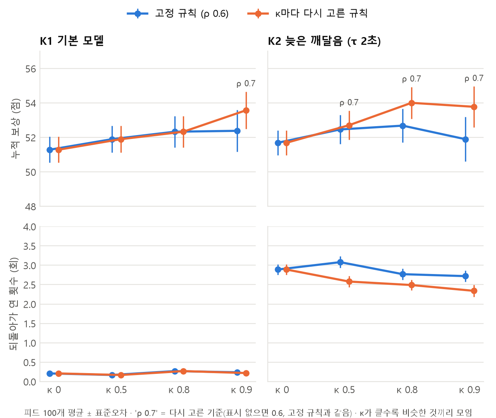
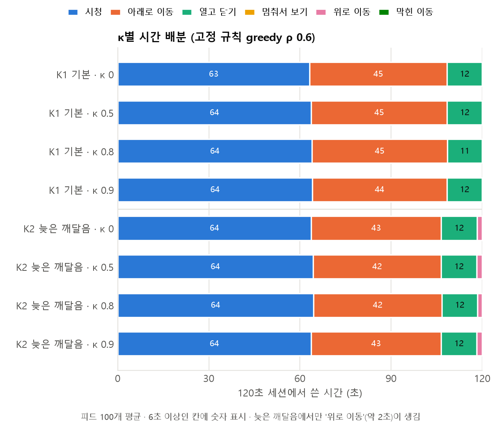
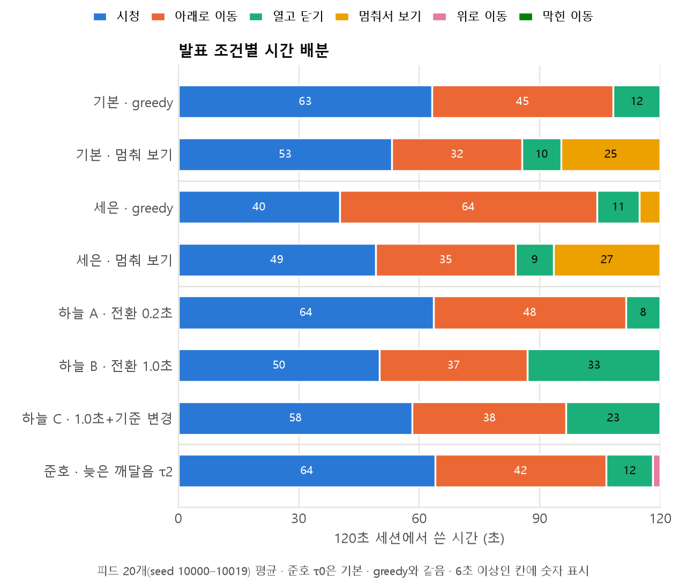

# κ(모이는 정도) 실험과 발표 조건의 시간 배분

- 작성: 2026-10-27 · 박준호 (Claude Code로 실행) · 2차 발표용 추가 실험
- 목적: 교수님 초안 09장 우선 축 중 결과가 없던 **κ(비슷한 콘텐츠가 모이는 정도)**를 채우고, 기존 발표 결과에 **시간 배분** 지표를 붙인다.
- 범위: 규칙 정책 시뮬레이션만(PPO 학습 없음). 패키지 코드(환경·피드·정책)는 고치지 않았고, 실험 스크립트만 새로 만들었다.

## 요약

1. **순서만 바꾼 κ는 고정 규칙의 결과를 바꾸지 않았다.** 같은 콘텐츠 집합에서 κ를 0 → 0.9로 올려도(인접 유형 유지율 0.58 → 0.95), 누적 보상·시간 배분·탐색 깊이가 κ0과 **차이 없음**(차이 0.6–1.1점, 모두 표준오차 0.7–1.2의 1.1배 이내).
2. **"κ가 클수록 되돌아가 여는 일이 많아진다"는 가설은 지지되지 않았다.** 되돌아가 열기는 늦은 깨달음 모델(K2)에서만 생기고(피드당 약 3회, 기본 모델은 0.2회), κ를 바꿔도 2.9 → 2.7–3.1회로 차이 없음.
3. **기준을 κ마다 다시 고르면 몰린 피드에서 ρ가 0.6 → 0.7로 올라가고, 조금 더 낫다.** 같은 피드에서 고정 규칙 대비 +1.2점(K1 κ0.9), +1.3·+1.9점(K2 κ0.8·0.9). 더 까다롭게 골라 덜 열고(−2회) 더 멀리 탐색한다(+8.5–10번째). 효과 크기는 점수의 2–4%.
4. **기존 발표 숫자는 모두 다시 나왔다**(실험 T). 시간 배분을 붙이면 각 조건의 손실이 어디서 생기는지 보인다: 멈춰 보기는 약 25초를 정지에, 세은 조건 greedy는 64초를 아래로 이동에, 하늘 B는 33초를 열고 닫기에 쓴다.

## 1. 설정과 재현

| 항목 | 값 |
|---|---|
| 실험 브랜치 | `exp/kappa-order` (`feature/ppo` @ `39580c0`에서 시작, 스크립트만 추가) |
| K1 · T(기본·세은) 코드 | `feature/ppo` @ `39580c0` |
| K2 · T(준호) 코드 | `feature/offscreen-residual` @ `a57c720` (`ddm.tau_residual = 2.0`) |
| T(하늘) 코드 | `feature/auto-preview` @ `d10b08d` (자동 미리보기 **꺼짐**) |
| 평가 피드 | K1·K2: seed 10000–10099(100개) · T: seed 10000–10019(20개) |
| κ | 원래 순서(생성 그대로, 기본 κ 0) / 0 / 0.5 / 0.8 / 0.9 — 기본값이 0이라 지시문의 "기본값" 대신 0.8을 넣음 |
| 순서만 바꾸기 | `feed.reorder_feed`: 각 콘텐츠의 (z, A, ν, λ) 묶음과 z=1 개수를 그대로 두고 유형 순서만 κ로 다시 뽑음. 재정렬 난수 = `default_rng([seed, 100κ, 2027])` |
| DDM 난수 | `env.reset(seed, options={"feed": 재정렬 피드})` → κ끼리 같은 seed |
| 고정 규칙 | `GreedyKnown` ρ 0.6 |
| 다시 고른 규칙 | `GreedyKnown` ρ를 κ마다 격자 0.1–1.5(0.1 간격)에서 seed 20000–20029(같은 방식으로 재정렬)의 평균 누적 보상이 최대인 값으로 |
| 참고 | `ScrollFirst` ρ 0.6 · 상한 = 참조 해(모두 알고 이동·전환 0, 순서와 무관 → seed마다 한 번) |
| 하늘 정책 | `SplitGreedy`(열기 ρ / 종료 ρ)를 슬라이드 설명대로 실험 스크립트에 다시 만듦 — 원래 숫자 54.73·40.58·42.71이 정확히 재현됨 |

```powershell
# exp/kappa-order 작업 폴더에서 (venv 활성화)
$W = "C:\Workspace\scrolling-agent\.worktrees"
python scripts\experiments\kappa_order.py k1      --code $W\feature_ppo\src
python scripts\experiments\kappa_order.py k2      --code $W\feature_offscreen-residual\src
python scripts\experiments\kappa_order.py t-ppo   --code $W\feature_ppo\src
python scripts\experiments\kappa_order.py t-hanul --code $W\feature_auto-preview\src
python scripts\experiments\kappa_order.py t-junho --code $W\feature_offscreen-residual\src
python scripts\experiments\summarize_kappa_order.py > results\kappa_order\summary.md
python scripts\experiments\figures_kappa_order.py
```

### 지표 정의 (실험 스크립트가 매 스텝 기록)

- **누적 보상** = 시청 보상 합 − 고정 비용 N·c(= 1200 × 0.01 = 12). 기존 발표의 "52.7"도 이 값(시청 보상 64.66 − 12).
- **시간 배분(초)**: 목록 모드 스텝을 행동별로 아래로 / 위로 / 멈춰서 보기(stay) / 막힌 이동(이동 행동인데 위치가 그대로)으로 나누고, 시청·열고 닫기(전환)와 합쳐 **모든 피드에서 120.00초**임을 확인.
- **되돌아가 연 횟수(재방문 클릭)**: 화면에 보였다가 화면 위쪽으로 지나간 콘텐츠(보이는 부분이 가시 기준 미만, env와 같은 허용 오차)를 다시 올라가 연 횟수. 위로 가지 않는 `ScrollFirst`에서 0임을 확인.
- **재시청**: 이미 본 시간이 있는 콘텐츠를 다시 연 횟수 · **알려진 후보 선택률**: 연 서로 다른 콘텐츠 수 ÷ 이해 완료 수 · **종료 시 보상률**: back을 고른 순간 그 콘텐츠의 실제 A·e^(−λw)(세션 종료로 끝난 시청은 따로 셈).
- 표의 값은 피드별 값의 평균 ± 표준오차. κ 사이 비교는 **같은 피드끼리 짝지은 차이**의 평균 ± 표준오차이고, |차이| ≤ 표준오차면 "차이 없음", 2배 이내면 "≈ 차이 없음"으로 적었다.

## 2. 피드 점검 — 집합은 같고 순서만 다름

| 순서 | 인접 유형 유지율 | z=1 개수 | ν–A 상관(log) | A 평균 | ν 평균 | λ 평균 |
|---|---|---|---|---|---|---|
| 원래 순서 | 0.579 | 30.54 | 0.017 | 0.837 | 1.042 | 0.315 |
| κ 0 | 0.576 | 30.54 | 0.017 | 0.837 | 1.042 | 0.315 |
| κ 0.5 | 0.784 | 30.54 | 0.017 | 0.837 | 1.042 | 0.315 |
| κ 0.8 | 0.909 | 30.54 | 0.017 | 0.837 | 1.042 | 0.315 |
| κ 0.9 | 0.951 | 30.54 | 0.017 | 0.837 | 1.042 | 0.315 |

100개 피드 평균. 인접 유형 유지율만 바뀌고 z=1 개수, ν–A 상관, A·ν·λ 평균은 κ마다 완전히 같다(K2도 같은 피드).

## 3. 실험 K1 — 순서만 바꾸기 (기본 모델)



| 순서 | 고정 규칙 누적 보상 | κ0 대비 | 다시 고른 ρ | 다시 고른 규칙 누적 보상 | 고정 규칙 대비 (같은 피드) | ScrollFirst | 상한 대비 % (고정) |
|---|---|---|---|---|---|---|---|
| 원래 순서 | 52.70 ± 0.71 | +1.41 ± 0.68 | 0.6 | 같음 | – | 52.49 ± 0.71 | 50.8 |
| κ 0 | 51.29 ± 0.75 | 기준 | 0.6 | 같음 | – | 51.24 ± 0.75 | 49.5 |
| κ 0.5 | 51.90 ± 0.78 | +0.61 ± 0.75 차이 없음 | 0.6 | 같음 | – | 51.94 ± 0.77 | 50.1 |
| κ 0.8 | 52.33 ± 0.91 | +1.05 ± 0.98 ≈ 차이 없음 | 0.6 | 같음 | – | 52.19 ± 0.91 | 50.6 |
| κ 0.9 | 52.38 ± 1.21 | +1.10 ± 1.14 차이 없음 | **0.7** | 53.57 ± 1.08 | **+1.19 ± 0.43** (깊이 +8.6, 클릭 −2.2) | 52.17 ± 1.19 | 50.5 |

- 시간 배분(고정 규칙): 모든 κ에서 시청 63–64초 · 아래로 44–45초 · 열고 닫기 11.5–11.6초 · 위로 0.02–0.03초 · 멈춤 0 · 막힌 이동 0 → 차이 없음.
- 되돌아가 연 횟수: 0.17–0.27회(차이 없음). 이해 수 59–60, 최대 깊이 68–70번째, 클릭 29회, 종료 시 보상률 0.59(= ρ 바로 아래에서 닫음), 재시청 0.

## 4. 실험 K2 — 재방문이 생기는 조건 (늦은 깨달음 τ 2초)

K1에서 되돌아가 열기가 거의 0이어서 실행했다(지시문 조건 충족). 피드·seed·κ·정책은 K1과 같다.

| 순서 | 고정 규칙 누적 보상 | κ0 대비 | 고정 규칙 되돌아가 연 횟수 | κ0 대비 | 다시 고른 ρ | 다시 고른 규칙 누적 보상 | 고정 대비 (같은 피드) | 다시 고른 규칙 되돌아가 연 횟수 |
|---|---|---|---|---|---|---|---|---|
| 원래 순서 | 53.18 ± 0.76 | +1.49 ± 0.69 | 3.16 ± 0.16 | +0.27 ± 0.20 | 0.6 | 같음 | – | 3.16 |
| κ 0 | 51.69 ± 0.72 | 기준 | 2.89 ± 0.14 | 기준 | 0.6 | 같음 | – | 2.89 |
| κ 0.5 | 52.46 ± 0.85 | +0.77 ± 0.79 차이 없음 | 3.08 ± 0.15 | +0.19 ± 0.18 ≈ 차이 없음 | **0.7** | 52.71 ± 0.85 | +0.24 ± 0.34 차이 없음 | 2.58 (−0.50 ± 0.15) |
| κ 0.8 | 52.68 ± 0.98 | +0.99 ± 1.06 차이 없음 | 2.77 ± 0.14 | −0.12 ± 0.20 차이 없음 | **0.7** | 54.01 ± 0.92 | **+1.32 ± 0.52** | 2.49 (−0.28 ± 0.13) |
| κ 0.9 | 51.90 ± 1.30 | +0.21 ± 1.18 차이 없음 | 2.72 ± 0.15 | −0.17 ± 0.19 차이 없음 | **0.7** | 53.78 ± 1.19 | **+1.88 ± 0.52** | 2.34 (−0.38 ± 0.17) |

- 시간 배분(고정 규칙): 위로 이동이 1.6–1.9초 생기고 아래로가 42–43초로 줄어드는 것 외에는 K1과 비슷하며, κ에 따른 차이는 없다.
- 다시 고른 규칙(ρ 0.7)은 아래로 48–49초, 시청 59–60초로 탐색 쪽으로 시간이 옮겨 가고(최대 깊이 +8.5–10.4번째), 되돌아가 열기는 오히려 줄어든다.



## 5. 실험 T — 기존 발표 결과의 시간 배분

| 조건 | 브랜치 | 설정 | 정책 | 슬라이드 | 다시 계산 | 시청 | 아래로 | 위로 | 멈춤 | 열고 닫기 | 이해 수 | 최대 깊이 | 클릭 | 클릭당 시청(초) | 되돌아가 열기 |
|---|---|---|---|---|---|---|---|---|---|---|---|---|---|---|---|
| 기본 | ppo@39580c0 | 기본값 | greedy ρ0.6 | 52.7 | 52.66 ± 1.93 | 63.2 | 45.0 | 0.0 | 0.0 | 11.8 | 61.3 | 69.5 | 29.7 | 2.16 | 0.25 |
| 기본 | ppo@39580c0 | 기본값 | greedy-dwell ρ0.6 dwell0.5 | 42.0 | 41.95 ± 1.68 | 53.1 | 32.4 | 0.0 | 24.7 | 9.8 | 50.1 | 50.8 | 24.8 | 2.18 | 0.05 |
| 세은 | ppo@39580c0 | feed.d_nu = −0.8 | greedy ρ0.6 | 26.3 | 26.25 ± 1.58 | 40.2 | 64.0 | 0.1 | 5.1* | 10.6 | 70.8 | 97.8 | 26.8 | 1.51 | 0.60 |
| 세은 | ppo@39580c0 | feed.d_nu = −0.8 | greedy-dwell ρ0.6 dwell0.5 | 37.7 | 37.72 ± 1.65 | 49.1 | 34.9 | 0.0 | 26.6 | 9.5 | 51.0 | 54.5 | 23.9 | 2.09 | 0.05 |
| 하늘 A | auto-preview@d10b08d | 전환 0.2초 | SplitGreedy 열기0.8/종료0.6 | 54.73 | 54.73 ± 1.92 | 63.6 | 47.9 | 0.0 | 0.0 | 8.5 | 65.3 | 73.9 | 21.4 | 2.99 | 0.10 |
| 하늘 B | auto-preview@d10b08d | 전환 1.0초 | SplitGreedy 열기0.8/종료0.6 | 40.58 | 40.58 ± 1.57 | 50.1 | 36.9 | 0.0 | 0.0 | 33.0 | 50.2 | 57.1 | 16.9 | 3.00 | 0.05 |
| 하늘 C | auto-preview@d10b08d | 전환 1.0초 | SplitGreedy 열기1.2/종료0.4 | 42.71 | 42.71 ± 1.55 | 58.3 | 38.3 | 0.0 | 0.0 | 23.4 | 52.0 | 59.5 | 12.1 | 4.85 | 0.10 |
| 준호 | offscreen@a57c720 | τ 0 | greedy ρ0.6 | 52.7 | 52.66 ± 1.93 | 63.2 | 45.0 | 0.0 | 0.0 | 11.8 | 61.3 | 69.5 | 29.7 | 2.16 | 0.25 |
| 준호 | offscreen@a57c720 | τ 2.0 | greedy ρ0.6 | 53.5 | 53.52 ± 1.90 | 64.0 | 42.5 | 1.9 | 0.0 | 11.7 | 60.9 | 62.9 | 29.4 | 2.20 | 3.00 |

시간은 초(피드 20개 평균, 막힌 이동은 모든 조건에서 0). \* 세은 greedy의 "멈춤"은 목록 끝(99번째)에 닿아 기다린 시간.

- **슬라이드 숫자는 모두 재현됐다**(차이 0.05 이하, 반올림 차이). 세은님의 세 숫자는 hard_good greedy(26.3) · **기본 설정** greedy-dwell(42.0) · hard_good greedy-dwell(37.7)이다.
- 하늘님 조건의 `SplitGreedy`는 저장소에 없어 다시 만들었고, 세 숫자가 소수 둘째 자리까지 같다.



## 6. 해석

같은 콘텐츠를 모아 놓기만 해서는(κ 0 → 0.9) 고정 규칙 에이전트의 성과와 시간 배분이 달라지지 않았다. 손으로 정한 greedy 규칙은 "알아본 것 중 기준 이상이면 열고, 아니면 아래로" 움직일 뿐이라 좋은 구간이 몰려 있는지 흩어져 있는지를 이용하지 않기 때문이다. 되돌아가 열기도 화면 밖 잔여 처리(K2)가 있어야 생기며, 그 횟수는 κ와 무관했다. 따라서 "후보가 모여 있을수록 되돌아간다"는 가설은 이 규칙 정책에서는 지지되지 않는다. 기준 ρ를 κ마다 다시 고르면 몰린 피드(K1 κ0.9, K2 κ≥0.8)에서 ρ가 0.7로 올라가고, 같은 피드에서 고정 규칙보다 1.2–1.9점(점수의 2–4%) 높았다. 더 까다롭게 골라 덜 열고 더 멀리 탐색하는 쪽이 몰린 피드에서 조금 유리하다는 뜻이다.

이 결과는 교수님 초안의 두 비교와 같지 않다. "고정 규칙"은 사람이 정한 규칙을 그대로 둔 것이지 **학습한 정책을 고정한 채 피드만 바꾼 "변경 직후"**가 아니고, "다시 고른 규칙"은 기준 하나만 격자에서 고른 것이지 **정책 전체를 다시 학습한 "적응"**이 아니다. 학습한 정책은 몰린 구간을 기억해 머무르거나 되돌아가는 행동을 배울 수 있으므로, κ의 효과는 PPO로 두 비교를 다시 해야 확인할 수 있다.

**주의**: "원래 순서"와 "κ 0 셔플"은 같은 분포인데도 같은 피드에서 +1.4 ± 0.7점(K1·K2·ScrollFirst 모두 비슷) 차이가 났다. 피드 100개에서 이 정도의 우연 변동이 생길 수 있다는 뜻이므로, 위의 κ 효과(대부분 1점 안팎)는 "차이 없음"으로 읽는 것이 맞다. 다시 고른 규칙과 고정 규칙의 차이(+1.2–1.9)는 같은 피드·같은 순서의 짝 비교라 표준오차가 0.4–0.5로 작아서 이 주의와는 별개다.

## 7. 파일

| 파일 | 내용 |
|---|---|
| `scripts/experiments/kappa_order.py` | 실험 실행(K1·K2·T), 지표 기록, `SplitGreedy` |
| `scripts/experiments/summarize_kappa_order.py` | 평균 ± 표준오차, 짝 비교 표 → `results/kappa_order/summary.md`(전체 표) |
| `scripts/experiments/figures_kappa_order.py` | 그림 3장 |
| `results/kappa_order/k1_per_feed.csv`, `k2_per_feed.csv` | 피드별 원자료(5 순서 × 3 정책 × 100 피드) |
| `results/kappa_order/k1_tuning.csv`, `k2_tuning.csv` | ρ 격자별 평균 누적 보상(seed 20000–20029) |
| `results/kappa_order/k1_feed_check.csv`, `k2_feed_check.csv` | 피드 점검값 |
| `results/kappa_order/t-ppo_per_feed.csv`, `t-hanul_per_feed.csv`, `t-junho_per_feed.csv` | 실험 T 피드별 원자료 |
| `docs/reports/images/2026-10-27-kappa-order/*.png` | 그림 1–3 (6.4 × 5.4인치, 200dpi, 16:9 슬라이드 절반) |
